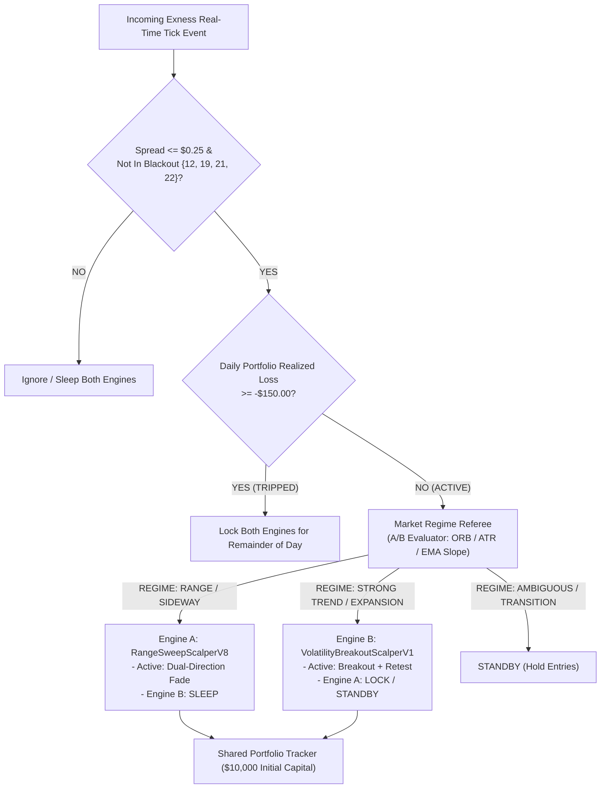
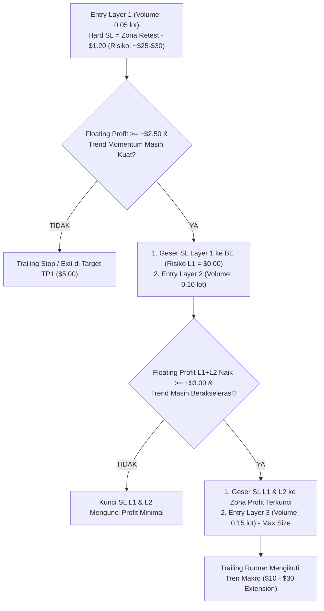

# Spesifikasi Teknis & Daftar Tiket: Fase K
## EXP-12: Regime-Switching Dual-Engine Architecture & Pyramiding Breakout Rider

**Proyek:** XAUUSD Quantitative Scalping Research Platform  
**Fase:** Fase K - Dual-Engine Adaptive Architecture & Multi-Layer Trend Pyramiding  
**Versi Dokumen:** 1.0.0  
**Tanggal:** 2026-11-08  
**Status Target:** Arsitektur Standar Institusional pada 53.541.349 Tick Riil Exness (`XAUUSDm`, April – November 2026)  

---

## 1. Latar Belakang & Diagnosa Kritis (Post-EXP-11)

### 1.1 Masalah Fundamental Strategi Tunggal
Evaluasi 8 bulan longitudinal pada `EXP-11` mengungkap dikotomi mendasar pada instrumen XAUUSD:
1. **Keunggulan Ekstrem di Pasar Sideway / Normal:**
   * Di bulan November 2026, `RangeSweepScalperV8` mencetak **Profit Factor 2.49**, **Win Rate 41.0%**, dan return **+13.59% (+$1.048,98)** hanya dalam seminggu.
   * Di bulan Juli (+$348,54) dan September (+$90,86), strategi mencetak net profit bersih dari spread dan latensi.
2. **Kelemahan Fatal pada Rezim Tren Agresif (The "Trend Day Trap"):**
   * Di bulan Agustus (reli parabolik emas +$678) dan Oktober (reli pre-election AS), bot mean-reversion terus berusaha melakukan *fade* (melawan arus).
   * Dari 72 hari perdagangan, tercatat **30 hari** menyentuh *Daily Circuit Breaker* (-$150/hari) dengan akumulasi kerugian mencapai **-$4.500**, yang mengikis habis seluruh keuntungan yang dikumpulkan di hari sideway.

### 1.2 Solusi Institusional: Dual-Engine Regime Switching
Tidak ada satu strategi tunggal yang mampu menguasai pasar sideway sekaligus pasar trending ekspansif. Solusi teruji adalah memadukan dua mesin yang beroperasi secara ortogonal:
* **Engine A (Mean-Reversion):** `RangeSweepScalperV8` (mengambil likuiditas sweep batas rentang $3–$10).
* **Engine B (Trend-Following):** `VolatilityBreakoutScalperV1` (menunggangi breakout dengan konfirmasi retest dan pyramiding bertahap).
* **Wasit Rezim (Regime Referee):** Mengendalikan sakelar (*switch*) untuk menentukan mesin mana yang berhak memegang kendali eksekusi.

---

## 2. Arsitektur Teknis Sistem (`AdaptiveDualEngineScalper`)

---

## 3. Cetak Biru Logika Komponen Utama

### 3.1 Komponen Wasit Rezim (`MarketRegimeDetector` - Matriks Evaluasi 3 Opsi)
Wasit akan menguji 3 opsi penentuan rezim secara modular (*pluggable*):

1. **Opsi 1: Opening Range Breakout (ORB London/NY)**
   * Menetapkan batas rentang pada 1 jam pertama sesi London (07:00–08:00 UTC).
   * Jika mid-price keluar menembus rentang ORB melebihi threshold ($\ge \$3.00$), rezim berubah menjadi `STRONG_BULLISH_TREND` atau `STRONG_BEARISH_TREND`.
2. **Opsi 2: Dynamic ATR & Daily Range Expansion**
   * Mengukur deviasi harga dari harga pembukaan hari (00:00 UTC Open).
   * Jika $|Price_{mid} - Price_{open}| \ge \$15.00$ s/d $\$20.00$ (atau $> 1.2 \times ATR_{14}$ D1), status pasar seketika beralih dari `RANGE` ke `EXPANSION_TREND`.
3. **Opsi 3: Macro EMA Slope & Momentum Classifier**
   * Memonitor kemiringan (*first derivative / slope*) dari H1 $EMA_8$ vs $EMA_{24}$.
   * Jika $|FastEMA - SlowEMA| \ge \$2.50$ dan sudut kemiringan $Slope \ge 0.15$ USD/jam, pasar diklasifikasikan sebagai `MOMENTUM_TREND`.

---

### 3.2 Komponen Engine B: `VolatilityBreakoutScalperV1` (Breakout + Retest + Pyramiding)

#### A. Mekanisme Eksekusi (Breakout + Retest Confirmation)
Untuk menghindari *Fakeout* emas yang sering terjadi pada penembusan langsung:
1. **Fase Breakout:** Harga menembus level batas struktural ($R_H$ atau $R_L$) sejauh $\ge \$2.00$. Bot mencatat level breakout tapi **TIDAK** membuka posisi langsung.
2. **Fase Retest (Pullback):** Menunggu harga melakukan koreksi mikro mendekati level batas yang baru dijebol (toleransi pullback $\$0.50 – \$1.50$).
3. **Fase Konfirmasi Rejection:** Saat harga memantul kembali searah tren pada level retest, order **Layer 1** dieksekusi seketika.

#### B. Mekanisme Multi-Layer Pyramiding (Anti-Martingale / Adding to Winners)
Tidak ada penambahan posisi saat posisi floating minus. Penambahan layer hanya diizinkan saat posisi sebelumnya telah profit dan risikonya telah tereliminasi (*Guaranteed Risk Ceiling*):

#### Aturan Batas Risiko Berlapis (*Risk Ceiling Guarantees*):
* **Maksimum Risiko Akun:** Tidak pernah melebihi kerugian 1 trade Layer 1 ($\approx \$25 - \$30$).
* **Layer 2 (0.10 lot):** Hanya aktif jika SL Layer 1 sudah berada di Breakeven. Jika harga berbalik arah tiba-tiba, Layer 1 impas ($0), dan hanya Layer 2 yang terkena SL.
* **Layer 3 (0.15 lot):** Hanya aktif jika SL kumulatif telah mengunci profit neto positif. Jika terjadi *V-reversal*, seluruh keranjang posisi ditutup dengan status **TETAP NET PROFIT**.

---

## 4. Matriks Parameter Lengkap (`AdaptiveDualEngineScalper`)

| Parameter | Tipe | Nilai Default | Rationale Kuantitatif |
| :--- | :---: | :---: | :--- |
| `regime_mode` | `str` | `"DYNAMIC_EXPANSION"` | Mode wasit aktif (`"ORB"`, `"DYNAMIC_EXPANSION"`, `"EMA_SLOPE"`). |
| `daily_expansion_threshold_usd`| `float` | `15.00` | Ambang batas deviasi open price untuk trigger mode TREND. |
| `orb_session_start_hour_utc` | `int` | `7` | Pembukaan sesi London untuk acuan ORB. |
| `orb_threshold_usd` | `float` | `3.00` | Penetrasi minimum di luar batas ORB. |
| `breakout_min_penetration_usd` | `float` | `2.00` | Jarak breakout minimum sebelum mencari retest. |
| `retest_max_distance_usd` | `float` | `1.50` | Toleransi jarak retest dari batas breakout. |
| `pyramid_step_1_usd` | `float` | `2.50` | Jarak profit L1 sebelum mengizinkan penambahan L2. |
| `pyramid_step_2_usd` | `float` | `3.00` | Jarak profit L2 sebelum mengizinkan penambahan L3. |
| `layer_volumes` | `list[float]` | `[0.05, 0.10, 0.15]` | Pembobotan alokasi posisi bertingkat. |
| `trailing_stop_buffer_usd` | `float` | `1.50` | Jarak trailing stop runner di belakang puncak harga tertinggi. |
| `max_daily_loss_usd` | `float` | `150.00` | Batas sirkuit global portofolio harian. |
| `max_spread_usd` | `float` | `0.25` | Filter spread broker Exness. |

---

## 5. Work Breakdown Structure (Daftar Tiket Fase K)

| ID | Judul Tiket | Lingkup Kerja Utama | File Output | Status |
| :--- | :--- | :--- | :--- | :---: |
| `TICK-1101` | Phase K Technical Specification & Dual Blueprint | Dokumen spesifikasi teknis arsitektur dual-engine, piramidisasi layer, dan logika wasit 3 opsi. | `docs/PHASE_11_SPECIFICATION.md` | **DONE** |
| `TICK-1102` | `MarketRegimeDetector` Implementation | Engine wasit klasifikasi pasar real-time $O(1)$ mendukung 3 opsi (ORB, Daily Expansion, EMA Slope). | `src/strategies/regime_detector.py` | **DONE** |
| `TICK-1103` | `VolatilityBreakoutScalperV1` Implementation | Engine B khusus tren: Breakout penetrasi, deteksi retest pullback, dan pyramiding L1–L3 anti-martingale. | `src/strategies/volatility_breakout_scalper.py` | **DONE** |
| `TICK-1104` | `AdaptiveDualEngineScalper` Orchestrator | Engine orkestrator yang mengintegrasikan Engine A & B di atas shared portfolio dengan sirkuit harian. | `src/strategies/adaptive_dual_engine.py` | **DONE** |
| `TICK-1105` | Unit Verification & Pyramiding Safety Test Suite | Pengujian deterministik: aktivasi sakelar wasit, validasi SL breakeven sebelum L2/L3 masuk, dan unfreeze. | `tests/test_adaptive_dual_engine.py` | **DONE** |
| `TICK-1106` | EXP-12 Macro Longitudinal Benchmark (53.54M Ticks) | Eksekusi benchmark 8 bulan penuh membandingkan 3 opsi wasit melawan EXP-11 baseline (Target: Net Profitable). | `scripts/run_experiment_exp12.py` | **DONE** |
| `TICK-1107` | Ledger & Equity Curve Reconciliation | Pembaruan buku besar registry komparatif dan kurva equity kontinu multi-regime. | `docs/EXPERIMENT_REGISTRY.md` | **DONE** |

---

## 6. Kriteria Keberhasilan & Syarat Kelulusan (Gate Definition of Done)

1. **Uji Validasi Risiko Piramidisasi:**
   * Terbukti secara matematis bahwa penambahan Layer 2 dan Layer 3 tidak pernah mengekspos modal melebihi risiko awal Layer 1 (SL Layer 1 wajib sudah di BE atau Profit).
2. **Komparasi 3 Opsi Wasit:**
   * Menghasilkan data perbandingan performa terperinci antara Opsi 1 (ORB), Opsi 2 (Daily Expansion), dan Opsi 3 (EMA Slope).
3. **Pembalikan Kurva Equity Kontinu 8 Bulan (April s/d November 2026):**
   * EXP-12 wajib **membalikkan total PnL 8 bulan dari MINUS (-\$1.232 di EXP-11) menjadi NET POSITIF PROFITABLE**, dengan memanfaatkan reli besar di Agustus (+$678) dan Oktober melalui Engine B.
   * Max Drawdown kumulatif kontinu berhasil ditekan di bawah 25%.
