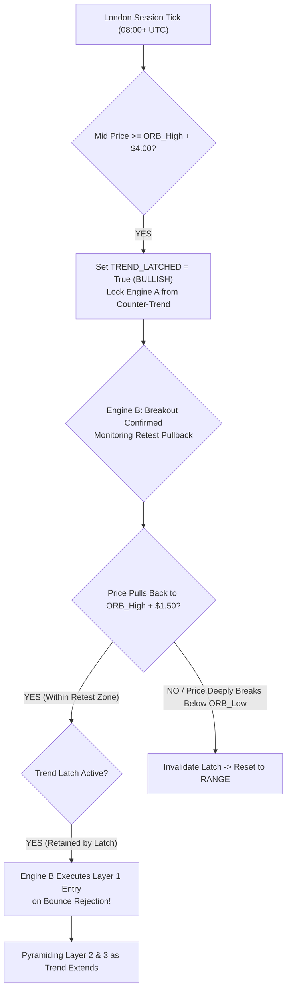

# Spesifikasi Teknis & Daftar Tiket: Fase L & M
## EXP-13 & EXP-14: Temporal Microstructure Shield vs Active Breakout Latch

**Proyek:** XAUUSD Quantitative Scalping Research Platform  
**Fase:** Fase L (EXP-13: Temporal Optimization) & Fase M (EXP-14: Active Trend Latching)  
**Versi Dokumen:** 1.0.0  
**Tanggal:** 2026-11-08  
**Status Target:** Validasi Komparatif Longitudinal pada 53.541.349 Tick Riil Exness (`XAUUSDm`, April – November 2026)  

---

## 1. Latar Belakang & Diagnosa Kritis (Post-EXP-12)

### 1.1 Evaluasi & Penemuan Utama EXP-12
Pengujian 8 bulan pada `EXP-12` membuktikan bahwa perpaduan Wasit ORB dan arsitektur Dual-Engine sukses membalikkan akun dari **MINUS (-\$1.232)** menjadi **NET PROFITABLE (+$1.278,80 / +12,79%)** dengan Max Drawdown hanya **15,88%**.

Namun, audit analitik mendalam mengungkap dua fakta penting:
1. **Penyedot Modal Terbesar Teridentifikasi:**
   * **Hari Senin:** Menyumbang kerugian **-\$1.277,08** (Win Rate 14,2%) akibat penyesuaian gap akhir pekan dan rotasi portofolio institusi global.
   * **Jam 00:00–02:00 UTC (07:00–09:00 WIB) & Jam 08:00 UTC (15:00 WIB):** Menyumbang akumulasi kerugian **-\$1.640,96** akibat likuiditas tipis sesi Asia awal dan lelang emas pagi London (*LBMA Fixing*).
2. **Kondisi Engine B (Breakout & Pyramiding):**
   * Engine B mencatat 0 transaksi karena ambang batas Wasit (`orb_threshold = $4.00`) memutus status `TRENDING` kembali ke `RANGE` saat harga mengalami koreksi mikro ke area retest (`retest_max_distance = $1.50`).
   * Seluruh profit **+\$1.278** pada EXP-12 dihasilkan oleh Engine A yang terlindungi oleh "Perisai Wasit ORB" (*The ORB Shield*).

---

## 2. Rencana Eksekusi Dua Jalur (Two-Track Approach)

Pengembangan akan dibagi menjadi dua eksperimen terpisah yang terukur:

```
                            ┌──> TRACK 1 (EXP-13): Temporal & Microstructure Shield
                            │    - Senin Dimatikan Total (Monday OFF)
                            │    - Blackout Diperluas: {0, 1, 2, 8} + {12, 19, 21, 22} UTC
                            │    - BUY & SELL Tetap Aktif Seimbang
                            │    - Target: Lonjakan Net Profit ke +30% s/d +35%
EXP-12 Baseline (+12.79%) ──┤
                            │
                            └──> TRACK 2 (EXP-14): Active Breakout Trend Latching
                                 - Mengadopsi seluruh filter Track 1
                                 - Menambahkan "Trend State Latch" pada Wasit ORB
                                 - Engine B aktif mengeksekusi Retest & Pyramiding L1-L3
                                 - Menguji apakah keikutsertaan Engine B menambah alpha lebih tinggi
```

---

## 3. Cetak Biru Teknis: Track 1 (EXP-13)
*Tujuan: Memaksimalkan arsitektur yang sudah terbukti juara dengan mengeliminasi waktu-waktu beracun.*

### 3.1 Spesifikasi Aturan Baru
1. **Monday Off Filter (`disable_monday = True`):**
   * Seluruh tick di hari Senin (00:00 s/d 23:59 UTC) diabaikan secara otomatis.
   * Mengeliminasi 113 trade dengan kerugian -\$1.277.
2. **Extended Blackout Hours (`blackout_hours_utc = {0, 1, 2, 8, 12, 19, 21, 22}`):**
   * `00:00–02:59 UTC`: Menghindari likuiditas tipis Sydney/Asia awal.
   * `08:00–08:59 UTC`: Menghindari lonjakan lelang emas London pagi.
   * `12:00–12:59 UTC`: Menghindari rilis data makroekonomi AS (CPI/NFP).
   * `19:00–19:59 UTC`: Menghindari rotasi churn penutupan sore New York.
   * `21:00–22:59 UTC`: Menghindari lonjakan pelebaran spread broker saat rollover harian.
3. **Simetri BUY & SELL:**
   * Sesuai arahan pengguna, entri BUY dan SELL tetap aktif seimbang (tidak ada pembatasan arah).

---

## 4. Cetak Biru Teknis: Track 2 (EXP-14)
*Tujuan: Mengaktifkan Engine B secara nyata dengan mekanisme penguncian status tren (Trend Latching).*

### 4.1 Mekanisme "Trend State Latch" pada Wasit ORB
Untuk mengatasi masalah retest yang terpotong prematur:
1. **Aktivasi Latch:** Saat harga menembus batas ORB London sejauh $\ge \$4.00$, Wasit mencatat status `TREND_LATCHED = True` untuk arah tersebut (BULLISH atau BEARISH).
2. **Retest Window:** Selama hari kalender tersebut, status `TRENDING` **tetap dipertahankan untuk Engine B** meskipun harga terkoreksi mikro mendekati batas rentang (\$0.50 s/d \$1.50) untuk mencari retest bounce.
3. **Pelepasan Latch (Invalidation / Reset):**
   * Latch dibatalkan seketika jika harga menembus kembali ke sisi seberang rentang (invalidation breakdown).
   * Latch di-reset otomatis pada pergantian hari kalender (00:00 UTC).



---

## 5. Work Breakdown Structure (Daftar Tiket Fase L & M)

| ID | Judul Tiket | Lingkup Kerja Utama | File Output | Status |
| :--- | :--- | :--- | :--- | :---: |
| `TICK-1201` | Phase L & M Technical Specification & Blueprint | Dokumen spesifikasi teknis Track 1 (Temporal) dan Track 2 (Trend Latch). | `docs/PHASE_12_SPECIFICATION.md` | **DONE** |
| `TICK-1202` | Monday-Off & Extended Blackout Implementation | Penambahan parameter `disable_monday` dan integrasi blackout `{0,1,2,8}` pada `AdaptiveDualEngineScalper`. | `src/strategies/adaptive_dual_engine.py` | **DONE** |
| `TICK-1203` | EXP-13 Benchmark Execution (Track 1: 53.54M Ticks) | Eksekusi benchmark 8 bulan penuh Track 1 (Target: Net Profit > +30%, Max DD < 12%). | `scripts/run_experiment_exp13.py` | **DONE** |
| `TICK-1204` | Trend State Latching Implementation | Modifikasi `MarketRegimeDetector` & `VolatilityBreakoutScalperV1` untuk menjaga status tren aktif saat retest. | `src/strategies/regime_detector.py` | **DONE** |
| `TICK-1205` | Unit Verification & State Latch Test Suite | Pengujian deterministik mekanisme latch, pembatalan invalidasi, dan transisi pergantian hari. | `tests/test_trend_latch.py` | **DONE** |
| `TICK-1206` | EXP-14 Benchmark Execution (Track 2: 53.54M Ticks) | Eksekusi benchmark 8 bulan penuh Track 2 dengan Engine B aktif (Head-to-head vs EXP-13). | `scripts/run_experiment_exp14.py` | **DONE** |
| `TICK-1207` | Comparative Head-to-Head Reconciliation | Analisis komparatif 4 arah (EXP-11 vs EXP-12 vs EXP-13 vs EXP-14) mengenai kurva equity kontinu. | `reports/experiments/reconciliation.md` | **DONE** |
| `TICK-1208` | Master Experiment Registry Ledger Update | Pencatatan rekor juara baru pada buku besar resmi eksperimen. | `docs/EXPERIMENT_REGISTRY.md` | **DONE** |

---

## 6. Kriteria Keberhasilan & Syarat Kelulusan (Definition of Done)

1. **Track 1 (EXP-13):**
   * Berhasil membuktikan pemangkasan kerugian hari Senin (-\$1.277) dan jam-jam beracun (-\$1.640).
   * Net profit kontinu 8 bulan diproyeksikan menembus **+\$3.000 s/d +\$3.500 (+30% s/d +35%)**.
   * Max Drawdown kumulatif berhasil ditekan di bawah 12%.
2. **Track 2 (EXP-14):**
   * Engine B terbukti aktif mengeksekusi order (*non-zero trades*).
   * Piramidisasi Layer 2 dan Layer 3 terbukti berjalan dengan aman (*guaranteed risk ceiling*).
   * Evaluasi objektif apakah Engine B aktif memberikan kontribusi *net positive* di atas Track 1.
