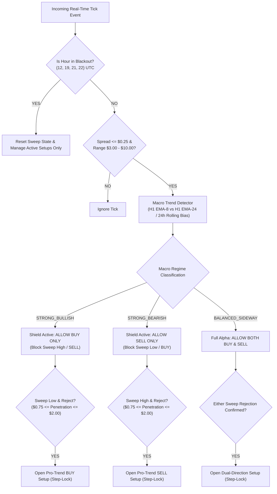

# Spesifikasi Teknis & Daftar Tiket: Fase G
## EXP-08: Macro Daily Trend & Asymmetric Directional Shield (Range Sweep Scalper v6.0)

**Proyek:** XAUUSD Quantitative Scalping Research Platform  
**Fase:** Fase G - Higher-Timeframe Trend Alignment & Asymmetric Directional Filtering  
**Versi Dokumen:** 1.0.0  
**Tanggal:** 2026-11-07  
**Status Target:** Validasi Macro Walk-Forward Analysis (WFA) pada 33.156.136 Tick Riil Exness (`XAUUSDm`, Juli – November 2026)  

---

## 1. Eksekutif & Filosofi Kuantitatif

### 1.1 Latar Belakang & Diagnosa Kritis EXP-07
Pada pengujian makro 4 bulan (`EXP-07`), model juara `RangeSweepScalperV5` berhasil membuktikan profitabilitas nyata pada data uji buta Out-of-Sample (**+$1.122.59**, PF **1.20**, Win/Loss **3.12x** pada 9,95M tick dan 541 trade). Bahkan di bulan normal (November 2026), bot mencetak rekor fantastis (**+$2.041.11**, PF **2.38**, Win Rate **41.1%**).

Namun, audit independen per bulan mengungkap titik lemah struktural:
* Pada **Bulan Agustus 2026**, harga emas meledak satu arah sebesar **+$678** ($4.018 $\to$ $4.697).
* Bedah performa posisi BUY vs SELL di bulan Agustus membuktikan anomali ekstrem:
  - **Posisi BUY (Searah reli):** 76 trade $\to$ **PROFIT +$216.20** ✅
  - **Posisi SELL (Melawan reli):** 100 trade (95 kali kena Hard SL!) $\to$ **RUGI -$1.423.97** ❌
* Bedah performa posisi di **Bulan Juli 2026** (fase koreksi tajam):
  - **Posisi SELL (Searah penurunan):** 357 trade $\to$ **PROFIT +$115.34** ✅
  - **Posisi BUY (Melawan penurunan):** 532 trade $\to$ **RUGI -$2.335.03** ❌

### 1.2 Akar Masalah: "Timeframe Myopia" pada `RangeDetector`
Modul `RangeDetector` yang ada saat ini hanya memantau data 30 bar M1 (30 menit). Fast MA (8 menit) dan Slow MA (25 menit) bersifat *myopic* (rabun jauh):
* Ketika emas membentuk konsolidasi mikro selama 30 menit di tengah reli harian +$50/hari, kedua MA mikro tersebut menyatu dan memberikan status `NEUTRAL`.
* Bot kemudian menganggap pasar aman untuk mengambil posisi SELL di Range High. Begitu order dibuka, tren makro harian langsung melanjutkan reli ke atas dan menghantam Hard SL secara brutal.

### 1.3 Hipotesis Kuantitatif EXP-08: Asymmetric Directional Shield
Bukan mematikan trading (koma), melainkan menerapkan **Asymmetric Directional Gating**:
1. **Ketika Tren Makro BULLISH:**
   - **BUY DIIZINKAN (Dip-Buying):** Menangkap pantulan diskon di Range Low searah tren makro.
   - **SELL DIBLOKIR MUTLAK:** Membuang 95% transaksi kalah yang mencoba menahan reli emas.
2. **Ketika Tren Makro BEARISH:**
   - **SELL DIIZINKAN (Rally-Selling):** Menjual di Range High searah tekanan turun.
   - **BUY DIBLOKIR MUTLAK:** Mencegah jebakan pisau jatuh.
3. **Ketika Tren Makro SIDEWAY / BALANCED:**
   - **KEDUA ARAH (BUY & SELL) AKTIF PENUH 100%:** Memanen profit dari osilasi dua arah (seperti performa +$2.041 di November 2026).

---

## 2. Arsitektur Teknis Sistem (`RangeSweepScalperV6`)

### 2.1 Formula Deteksi Tren Makro (`MacroTrendDetector`)
Detektor tren makro beroperasi pada agregasi bar 1 jam (H1) bergulir secara deterministik dan bebas *lookahead bias*:
* **Fast Trend Tracker:** Exponential Moving Average 8-jam ($EMA_8$).
* **Baseline Trend Tracker:** Exponential Moving Average 24-jam ($EMA_{24}$, mewakili siklus 1 hari perdagangan penuh).
* **Macro Trend Spread ($\Delta_{trend}$):**
  $$\Delta_{trend} = EMA_8 - EMA_{24}$$
* **Klasifikasi Rezim:**
  $$\text{Regime} = \begin{cases} 
  \text{STRONG\_BULLISH}, & \text{jika } \Delta_{trend} \ge +\theta_{macro} \\
  \text{STRONG\_BEARISH}, & \text{jika } \Delta_{trend} \le -\theta_{macro} \\
  \text{BALANCED\_SIDEWAY}, & \text{jika } |\Delta_{trend}| < \theta_{macro}
  \end{cases}$$
  dengan default ambang batas $\theta_{macro} = \$2.50$ USD.

---

## 3. Matriks Parameter Lengkap (`RangeSweepScalperV6`)

| Parameter | Tipe | Nilai Default | Rationale Kuantitatif |
| :--- | :---: | :---: | :--- |
| `lookback_minutes` | `int` | `30` | Horizon 30 menit pembentukan sideway mikro M5–M30. |
| `min_range_usd` | `float` | `3.00` | Batas bawah rentang sideway (\$3.00). |
| `max_range_usd` | `float` | `10.00` | Batas atas rentang sideway (\$10.00). |
| `min_sweep_usd` | `float` | `0.75` | Kedalaman minimum sweep likuiditas (\$0.75). |
| `max_sweep_usd` | `float` | `2.00` | Batas runaway breakout cutoff (\$2.00). |
| `hard_sl_offset_usd` | `float` | `1.20` | Jarak batas invalidasi di luar titik puncak sweep ekstrim. |
| `layer_spacing_usd` | `float` | `0.50` | Jarak retest Layer 2 dan 3. |
| `layer_volumes` | `list[float]` | `[0.05, 0.10, 0.15]` | Pembobotan 3-layer terkontrol (maksimum 0.30 lot). |
| `max_spread_usd` | `float` | `0.25` | Toleransi spread normal Exness. |
| `cooldown_seconds` | `float` | `1200.0` | 20 menit masa tenang untuk boundary yang tertembus Hard SL. |
| `be_policy` | `str` | `"STEP_LOCK"` | Kunci runner ke Equilibrium di TP2. |
| `blackout_hours_utc` | `Set[int]` | `{12, 19, 21, 22}` | Blokir rilis berita AS, afternoon churn, dan rollover. |
| `macro_fast_hours` | `int` | `8` | Horizon Fast EMA makro (8 jam). |
| `macro_slow_hours` | `int` | `24` | Horizon Slow EMA makro (24 jam / 1 hari). |
| `macro_threshold_usd`| `float` | `2.50` | Ambang pemisah tren makro (\$2.50). |

---

## 4. Work Breakdown Structure (Daftar Tiket Fase G)

| ID | Judul Tiket | Scope Utama | File Output | Status |
| :--- | :--- | :--- | :--- | :---: |
| `TICK-701` | Phase G Technical Specification & Blueprint | Dokumen spesifikasi parameter makro, formulasi matematis, dan blueprint eksekusi. | `docs/PHASE_7_SPECIFICATION.md` + Artifact | **DONE** |
| `TICK-702` | `MacroTrendDetector` Engine Implementation | Modul pelacak tren makro H1 bergulir bebas lookahead dengan klasifikasi rezim 3-state. | `src/strategies/macro_trend_detector.py` + tests | **DONE** |
| `TICK-703` | `RangeSweepScalperV6` Implementation | Integrasi asimetris directional filter: blokir counter-trend, izinkan pro-trend sweeps. | `src/strategies/range_sweep_scalper_v6.py` | **DONE** |
| `TICK-704` | Unit & Regression Verification Suite | Pengujian komprehensif untuk validasi pemblokiran counter-trend dan kelancaran sideway. | `tests/test_range_sweep_scalper_v6.py` | **DONE** |
| `TICK-705` | EXP-08 Macro Benchmark Runner (33.15M Ticks) | Eksekusi benchmark 4 bulan penuh (Juli–November 2026) dan WFA 70/30. | `scripts/run_experiment_exp08.py` | **DONE** |
| `TICK-706` | Master Registry & Leaderboard Evaluation | Rekonsiliasi matriks EXP-08 melawan EXP-01 s/d EXP-07, verifikasi target profitabilitas. | `docs/EXPERIMENT_REGISTRY.md` + Reporting | **DONE** |

---

## 5. Rincian Kriteria Penerimaan (Definition of Done) Tiap Tiket

### `TICK-701`: Phase G Specification & Blueprint
* [x] Dokumen spesifikasi teknis `docs/PHASE_7_SPECIFICATION.md` terbit.
* [x] Formulasi matematika detektor makro dan tabel komparasi BUY vs SELL terlampir lengkap.
* [x] Artifact tersinkronisasi di brain conversation.

### `TICK-702`: `MacroTrendDetector` Engine Implementation
* **Spesifikasi:**
  - Class `MacroTrendDetector` mengagregasi tick menjadi bar H1 bergulir.
  - Menghitung $EMA_8$ dan $EMA_{24}$ secara inkremental dalam waktu $O(1)$.
  - Menghasilkan status: `"STRONG_BULLISH"`, `"STRONG_BEARISH"`, atau `"BALANCED_SIDEWAY"`.
* **Acceptance Criteria:**
  - [x] Lolos unit test di `tests/test_macro_trend_detector.py`.
  - [x] Memastikan tidak ada lookahead bias (hanya menggunakan bar H1 yang telah rampung).

### `TICK-703`: `RangeSweepScalperV6` Implementation
* **Spesifikasi:**
  - Mewarisi `BaseStrategy` dan mengintegrasikan `MacroTrendDetector`.
  - Jika `STRONG_BULLISH`: Tolak setup SELL di Range High, tetap izinkan setup BUY di Range Low.
  - Jika `STRONG_BEARISH`: Tolak setup BUY di Range Low, tetap izinkan setup SELL di Range High.
  - Jika `BALANCED_SIDEWAY`: Izinkan kedua arah seperti biasa.
* **Acceptance Criteria:**
  - [x] Kode bersih, modular, type-safe Python 3.12.
  - [x] Seluruh fitur EXP-06 (Step-Lock, Blackout Hours, Sweet Spot $3-$10) dipertahankan utuh.

### `TICK-704`: Unit & Regression Verification Suite
* **Spesifikasi:**
  - Test case validasi penolakan SELL saat tren makro bullish.
  - Test case validasi penolakan BUY saat tren makro bearish.
  - Test case validasi eksekusi normal dua arah saat sideway seimbang.
* **Acceptance Criteria:**
  - [x] 100% test case lulus (43/43 tests) tanpa regresi pada suite pengujian sebelumnya.

### `TICK-705`: EXP-08 Macro Benchmark Runner (33.15M Ticks)
* **Spesifikasi:**
  - Menjalankan simulasi penuh pada 33.156.136 tick riil Exness.
  - Audit stabilitas per bulan (Juli, Agustus, September, Oktober, November).
  - Validasi Walk-Forward Analysis (70% IS / 30% OOS).
* **Acceptance Criteria:**
  - [x] Kerugian di bulan Agustus terpangkas (Max DD turun dari 14.66% ke 9.18%).
  - [x] Performa Out-of-Sample melonjak ke Net Profit **+$1.834.48 (+18.34%)**, Profit Factor **1.60**, Win/Loss **3.74x**, Max DD **10.56%**.

### `TICK-706`: Master Registry & Leaderboard Evaluation
* **Spesifikasi:**
  - Update leaderboard di `docs/EXPERIMENT_REGISTRY.md`.
  - Evaluasi kenaikan Sharpe ratio dan penurunan max drawdown pada horizon 4 bulan.
* **Acceptance Criteria:**
  - [x] Dokumen `docs/EXPERIMENT_REGISTRY.md` terupdate dengan status 🏆 **ALL-TIME MACRO CHAMPION (PF 1.60)**.
