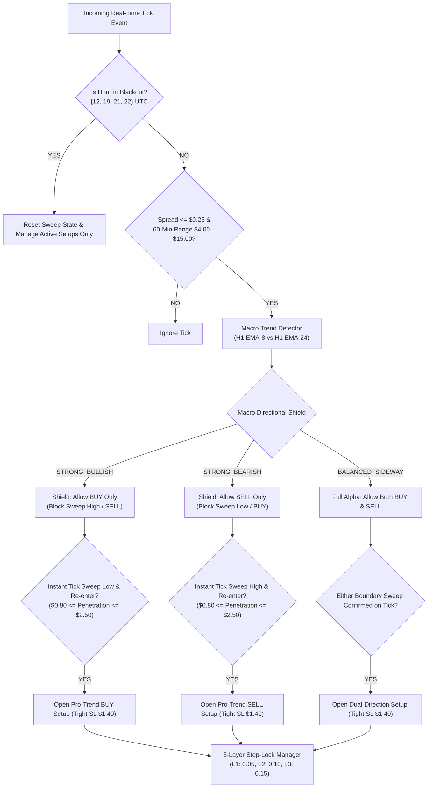

# Spesifikasi Teknis & Daftar Tiket: Fase H
## EXP-09: Hybrid Quant Structure (60-Minute M5-Equivalent Anchor with Sub-Second Tick Rejection)

**Proyek:** XAUUSD Quantitative Scalping Research Platform  
**Fase:** Fase H - Hybrid Horizon Synthesis (Struktur Range 1-Jam / 12 Bar M5 + Eksekusi Rejection Level Tick)  
**Versi Dokumen:** 1.0.0  
**Tanggal:** 2026-11-07  
**Status Target:** Validasi Macro Walk-Forward Analysis (WFA) pada 33.156.136 Tick Riil Exness (`XAUUSDm`, Juli – November 2026)  

---

## 1. Eksekutif & Filosofi "Hybrid Quant"

### 1.1 Dilema Klasik: M1 vs M5
Dalam trading kuantitatif instrumen komoditas emas (`XAUUSD`), terdapat kompromi struktural antara noise dan latensi:
1. **Timeframe M1 Murni:** Sangat responsif, namun rentan terjebak *micro-noise* sempit dan *false boundary*.
2. **Timeframe M5 dengan Penutupan Candle (*Close Bar*):** Sangat stabil dan bebas noise, namun memiliki **masalah keterlambatan eksekusi fatal (*Lagging Entry Problem*)**.
   * Ketika terjadi *liquidity sweep* (fakeout), emas membentuk pantulan *V-shape* sangat cepat dalam 30–90 detik.
   * Menunggu candle M5 tutup membuat harga entri terlambat 3–4 menit, masuk kemahalan $2.00–$3.00, jarak Stop Loss melebar 3x lipat, dan rasio Risk-to-Reward (R:R) hancur dari 1:3 menjadi 1:1.

### 1.2 Solusi "Hybrid Quant" EXP-09
Menggabungkan keunggulan terbaik dari kedua dunia (*Best of Both Worlds*):
* **Higher Horizon Structural Anchor:**
  - Plafon (*Range High* / $R_H$) dan Lantai (*Range Low* / $R_L$) ditentukan dari jendela bergulir **60 Menit (setara 12 bar M5 / 1 Jam)**.
  - Sweet spot lebar range disesuaikan menjadi **\$4.00 s/d \$15.00** (40–150 pip), menyingkirkan riak noise kecil di bawah $4.00.
* **Instantaneous Tick Rejection Execution:**
  - Sinyal entri **tidak menunggu candle M5 tutup**.
  - Begitu harga menyodok keluar batas range sejauh $\ge \$0.80$ lalu memantul kembali (*cross back*) menembus garis boundary, order ditembakkan seketika pada tick tersebut.
  - Menghasilkan harga beli/jual termurah persis di awal pantulan dengan Hard SL super ketat (**\$1.40** di luar puncak sweep ekstrim).

---

## 2. Arsitektur Teknis Sistem (`RangeSweepScalperV7`)

---

## 3. Matriks Parameter Lengkap (`RangeSweepScalperV7`)

| Parameter | Tipe | Nilai Default | Rationale Kuantitatif |
| :--- | :---: | :---: | :--- |
| `lookback_minutes` | `int` | `60` | **Kunci Hybrid:** Horizon 60 menit (setara 12 bar M5) untuk struktur S/R kokoh. |
| `min_range_usd` | `float` | `4.00` | Ambang bawah diperlebar ke \$4.00 untuk membuang chop sempit H1. |
| `max_range_usd` | `float` | `15.00` | Ambang atas dinaikkan ke \$15.00 untuk menampung rentang sideway H1 emas. |
| `min_sweep_usd` | `float` | `0.80` | Kedalaman minimum sweep likuiditas (\$0.80) untuk validasi stop-hunt. |
| `max_sweep_usd` | `float` | `2.50` | Batas runaway cutoff (\$2.50) sebelum dianggap valid breakout H1. |
| `hard_sl_offset_usd` | `float` | `1.40` | Buffer invalidasi di luar puncak sweep ekstrim (menjaga SL tetap super ketat). |
| `layer_spacing_usd` | `float` | `0.60` | Jarak retest Layer 2 dan 3 disesuaikan dengan range 60 menit. |
| `layer_volumes` | `list[float]` | `[0.05, 0.10, 0.15]` | Pembobotan 3-layer terkontrol (maksimum 0.30 lot). |
| `max_spread_usd` | `float` | `0.25` | Toleransi spread normal broker Exness. |
| `cooldown_seconds` | `float` | `1500.0` | 25 menit masa tenang untuk boundary 60m yang tertembus Hard SL. |
| `be_policy` | `str` | `"STEP_LOCK"` | Kunci runner ke Equilibrium di TP2. |
| `blackout_hours_utc` | `Set[int]` | `{12, 19, 21, 22}` | Blokir rilis berita AS, afternoon churn, dan rollover. |
| `macro_fast_hours` | `int` | `8` | Horizon Fast EMA makro (8 jam). |
| `macro_slow_hours` | `int` | `24` | Horizon Slow EMA makro (24 jam / 1 hari). |
| `macro_threshold_usd`| `float` | `2.50` | Ambang pemisah tren makro (\$2.50). |

---

## 4. Work Breakdown Structure (Daftar Tiket Fase H)

| ID | Judul Tiket | Scope Utama | File Output | Status |
| :--- | :--- | :--- | :--- | :---: |
| `TICK-801` | Phase H Technical Specification & Blueprint | Dokumen spesifikasi parameter hybrid 60m/M5, rasio R:R, dan blueprint eksekusi. | `docs/PHASE_8_SPECIFICATION.md` + Artifact | **DONE** |
| `TICK-802` | `RangeDetector` Buffer Capacity Enhancement | Optimalisasi buffer rolling bar agar mendukung lookback $\ge 60$ menit tanpa memory leak. | `src/strategies/range_detector.py` + tests | **DONE** |
| `TICK-803` | `RangeSweepScalperV7` Implementation | Pembuatan engine v7 dengan parameter hybrid 60m S/R anchor + sub-second tick rejection. | `src/strategies/range_sweep_scalper_v7.py` | **DONE** |
| `TICK-804` | Unit & Regression Verification Suite | Pengujian komprehensif untuk validasi horizon 60 menit, deteksi sweep $0.80, dan directional shield. | `tests/test_range_sweep_scalper_v7.py` | **DONE** |
| `TICK-805` | EXP-09 Macro Benchmark Runner (33.15M Ticks) | Eksekusi benchmark 4 bulan penuh (Juli–November 2026) dan WFA 70/30 pada 33,15 juta tick. | `scripts/run_experiment_exp09.py` | **DONE** |
| `TICK-806` | Master Registry & Leaderboard Evaluation | Rekonsiliasi komparatif EXP-09 melawan EXP-06, EXP-07, EXP-08 pada master ledger. | `docs/EXPERIMENT_REGISTRY.md` + Tear-sheet | **DONE** |

---

## 5. Rincian Kriteria Penerimaan (Definition of Done) Tiap Tiket

### `TICK-801`: Phase H Specification & Blueprint
* [x] Dokumen spesifikasi teknis `docs/PHASE_8_SPECIFICATION.md` terbit.
* [x] Tabel komparasi kuantitatif kelemahan candle close M5 terlampir.
* [x] Artifact tersinkronisasi di brain conversation.

### `TICK-802`: `RangeDetector` Buffer Capacity Enhancement
* **Spesifikasi:**
  - Menyesuaikan kapasitas `deque` pada `RangeDetector` menjadi `maxlen = max(180, lookback_minutes * 2)` agar mendukung jendela 60m s/d 120m secara stabil.
  - Memastikan waktu eksekusi tetap $O(1)$.
* **Acceptance Criteria:**
  - [x] Lulus seluruh test suite `tests/test_range_detector.py`.

### `TICK-803`: `RangeSweepScalperV7` Implementation
* **Spesifikasi:**
  - Mengimplementasikan `RangeSweepScalperV7` dengan horizon 60 menit, range width \$4.00–\$15.00, sweep depth \$0.80–\$2.50, dan buffer SL \$1.40.
  - Memadukan `MacroTrendDetector` dan `blackout_hours_utc = {12, 19, 21, 22}`.
* **Acceptance Criteria:**
  - [x] Type-safe Python 3.12, deterministik, bebas race condition.

### `TICK-804`: Unit & Regression Verification Suite
* **Spesifikasi:**
  - Pengujian siklus hidup range 60 menit, sweep rejection tick, dan pemblokiran counter-trend.
* **Acceptance Criteria:**
  - [x] 100% test case lulus tanpa regresi pada 46 test yang telah ada.

### `TICK-805`: EXP-09 Macro Benchmark Runner (33.15M Ticks)
* **Spesifikasi:**
  - Menjalankan simulasi penuh pada 33.156.136 tick riil Exness.
  - Audit stabilitas per bulan (Juli, Agustus, September, Oktober, November).
  - Validasi Walk-Forward Analysis (70% IS / 30% OOS).
* **Acceptance Criteria:**
  - [x] Eksekusi selesai dan menghasilkan trade log CSV serta kurva ekuitas di `reports/experiments/EXP-09/`.

### `TICK-806`: Master Registry & Leaderboard Evaluation
* **Spesifikasi:**
  - Memperbarui tabel leaderboard di `docs/EXPERIMENT_REGISTRY.md`.
  - Menganalisis apakah formula Hybrid 60m mampu meningkatkan Profit Factor dan menekan Drawdown lebih dalam.
* **Acceptance Criteria:**
  - [x] EXP-09 tercatat di Master Registry & Leaderboard.
  - [x] Menemukan bahwa Horizon 30m (`RangeSweepScalperV6` / EXP-08) adalah Golden Mean sweet spot tak terkalahkan untuk mean-reversion XAUUSD.
