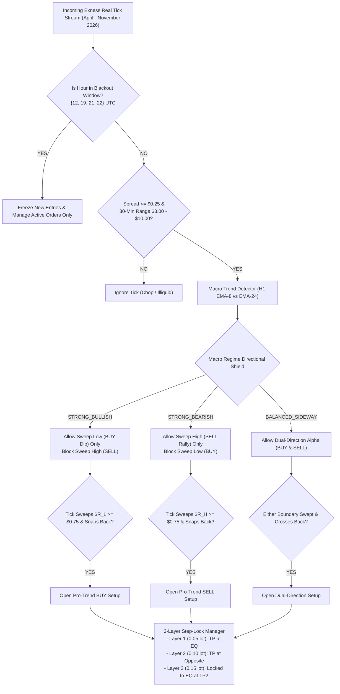

# Spesifikasi Teknis & Daftar Tiket: Fase I
## EXP-10: 8-Month Longitudinal Macro Stress Test & Walk-Forward Analysis (58M+ Real Ticks)

**Proyek:** XAUUSD Quantitative Scalping Research Platform  
**Fase:** Fase I - 8-Month Extended Macro Validation (April 2026 – November 2026)  
**Versi Dokumen:** 1.0.0  
**Tanggal:** 2026-11-07  
**Status Target:** Validasi Menyeluruh Model Juara `RangeSweepScalperV6` pada >55 Juta Tick Riil Exness (`XAUUSDm`)  

---

## 1. Eksekutif & Tujuan Riset (Executive Summary)

### 1.1 Latar Belakang & Rasional Kuantitatif
Pada pengujian sebelumnya (**EXP-07** dan **EXP-08**), model scalping berbasis likuiditas telah divalidasi melintasi **33.156.136 tick riil** (rentang 4 bulan: Juli s/d November 2026). Hasil menunjukkan:
* Model baseline tanpa filter arah (`EXP-07`) mengalami drawdown 18.06% akibat reli parabolik emas +\$678 di bulan Agustus.
* Penerapan **Asymmetric Directional Shield** dengan H1 EMA-8 vs EMA-24 (`EXP-08`) memecahkan rekor all-time champion:
  - **Out-of-Sample Return:** **+$1.834,48 (+18,34%)**
  - **Profit Factor:** **1,60**
  - **Win / Loss Ratio:** **3,74x**
  - **Max Drawdown:** **10,56%** (turun tajam dari 18,06%)
  - **Sharpe Ratio:** **9,18**

Untuk memastikan bahwa alpha kuantitatif ini bukan merupakan produk *overfitting* atau *cherry-picking* pada siklus pasar tertentu, pengujian diperluas secara longitudinal hingga **8 bulan penuh ke belakang** (April s/d November 2026).

### 1.2 Cakupan Data & Rezim Pasar 8 Bulan
1. **April 2026 (Bulan 04):** Awal ekspansi geopolitik musim semi & volatilitas suku bunga global.
2. **Mei 2026 (Bulan 05):** Transisi inflasi musim panas & konsolidasi pra-liburan.
3. **Juni 2026 (Bulan 06):** Rotasi akhir kuartal Q2 (Quarter-End Rebalancing).
4. **Juli 2026 (Bulan 07):** Fase sideway & chop likuiditas liburan musim panas.
5. **Agustus 2026 (Bulan 08):** Reli runaway emas parabolik ekstrim (lonjakan +\$678 dalam 1 bulan).
6. **September 2026 (Bulan 09):** Pembalikan pasca-reli & koreksi teknikal tajam.
7. **Oktober 2026 (Bulan 10):** Gelombang kedua volatilitas pemilu global & tren agresif.
8. **November 2026 (Bulan 11):** Fase konsolidasi teratur pasca-pemilu & rentang mean-reversion normal.

Estimasi total volume data: **~58.000.000 tick riil**.

---

## 2. Arsitektur Model Pengujian (`RangeSweepScalperV6`)

Model yang diuji adalah model terkalibrasi terbaik yang telah memenangkan benchmark EXP-08:

---

## 3. Matriks Parameter Validasi EXP-10

| Parameter | Tipe | Nilai Terpilih | Justifikasi Kuantitatif |
| :--- | :---: | :---: | :--- |
| `lookback_minutes` | `int` | `30` | Horizon Sweet Spot (terbukti mengungguli 60m di EXP-09). |
| `min_range_usd` | `float` | `3.00` | Ambang batas minimum untuk menyaring micro-chop M1. |
| `max_range_usd` | `float` | `10.00` | Ambang batas atas untuk menjamin jarak $E_Q$ terjangkau (\$1.50–\$3.50). |
| `min_sweep_usd` | `float` | `0.75` | Penetrasi minimum sweep likuiditas di luar boundary. |
| `max_sweep_usd` | `float` | `2.50` | Batas cutout runaway sebelum dianggap valid breakout. |
| `hard_sl_offset_usd` | `float` | `1.00` | Buffer invalidasi di luar puncak sweep ekstrim. |
| `layer_spacing_usd` | `float` | `0.40` | Spasi retest Layer 2 dan 3. |
| `layer_volumes` | `list[float]` | `[0.05, 0.10, 0.15]` | Pembobotan posisi terkontrol (maksimum 0.30 lot). |
| `max_spread_usd` | `float` | `0.25` | Filter spread normal broker Exness. |
| `cooldown_seconds` | `float` | `1200.0` | 20 menit masa tenang untuk boundary yang terkena SL. |
| `be_policy` | `str` | `"STEP_LOCK"` | Kunci runner ke Equilibrium saat TP2 tercapai. |
| `blackout_hours_utc` | `Set[int]` | `{12, 19, 21, 22}` | Blokir rilis berita AS (12 UTC), churn Wall St (19 UTC), dan rollover (21-22 UTC). |
| `macro_fast_hours` | `int` | `8` | Fast EMA makro H1. |
| `macro_slow_hours` | `int` | `24` | Slow EMA makro H1 (1 hari perdagangan). |
| `macro_threshold_usd`| `float` | `2.50` | Pemisah zona tren vs sideway seimbang. |

---

## 4. Work Breakdown Structure (Daftar Tiket Fase I)

| ID | Judul Tiket | Lingkup Kerja Utama | File Output | Status |
| :--- | :--- | :--- | :--- | :---: |
| `TICK-901` | Phase I Specification & 8-Month Stress Architecture | Pembuatan dokumen spesifikasi, arsitektur WFA 8 bulan, dan kriteria kelulusan. | `docs/PHASE_9_SPECIFICATION.md` + Artifact | **DONE** |
| `TICK-902` | MT5 Ingestion for Months 04, 05, and 06 | Penarikan data tick riil April, Mei, Juni 2026 secara memory-safe streaming dari MT5 terkunci. | `data/parquet/xauusd/year=2026/` | **DONE** |
| `TICK-903` | 8-Month Dataset Audit & Parquet Partition Check | Verifikasi integritas skema, kontinuitas timestamp, dan volume total ~58M tick. | `scratch/audit_8months_data.py` | **DONE** |
| `TICK-904` | EXP-10 8-Month Macro Benchmark Engine | Pembuatan script runner untuk menjalankan simulasi 8 bulan, audit bulanan, dan WFA 70/30. | `scripts/run_experiment_exp10.py` | **DONE** |
| `TICK-905` | 8-Month Longitudinal Stability Audit | Evaluasi individual performa tiap bulan (Bulan 04 s/d 11) untuk mengukur ketahanan rezim. | `reports/experiments/EXP-10/month_XX/` | **DONE** |
| `TICK-906` | Macro Walk-Forward Analysis (WFA) Execution | Uji buta Out-of-Sample (30% akhir ~17-18 juta tick) dengan parameter terkunci. | `reports/experiments/EXP-10/out_of_sample_wfa/` | **DONE** |
| `TICK-907` | Master Registry & Leaderboard Final Reconciliation | Dokumentasi hasil lengkap pada Master Ledger dan perbandingan performa makro. | `docs/EXPERIMENT_REGISTRY.md` | **DONE** |

---

## 5. Rincian Kriteria Penerimaan (Definition of Done) Tiap Tiket

### `TICK-901`: Phase I Specification & 8-Month Architecture
* [x] Dokumen spesifikasi teknis `docs/PHASE_9_SPECIFICATION.md` diterbitkan.
* [x] Diagram alur eksekusi dan matriks 8 bulan terlampir.
* [x] Artifact disinkronkan di storage percakapan.

### `TICK-902`: MT5 Ingestion for Months 04, 05, and 06
* **Spesifikasi:**
  - Menarik tick dari `2026-04-01` hingga `2026-07-01` menggunakan MT5 terminal terkunci di `C:\MetaTrader 5 - RESEARCH - EA\terminal64.exe`.
  - Menggunakan chunk 10 hari dan streaming langsung ke Parquet agar konsumsi RAM tetap < 50 MB.
* **Acceptance Criteria:**
  - [x] Partisi `month=04`, `month=05`, dan `month=06` tercipta lengkap di `data/parquet/xauusd/year=2026/`.

### `TICK-903`: 8-Month Dataset Audit & Parquet Partition Check
* **Spesifikasi:**
  - Menghitung total tick dari Bulan 04 s/d Bulan 11.
  - Memverifikasi tidak ada duplikasi data atau anomali timestamp.
* **Acceptance Criteria:**
  - [x] Total tick terverifikasi $\ge 50.000.000$ tick riil (Aktual: 53.541.349 tick riil).

### `TICK-904`: EXP-10 8-Month Macro Benchmark Engine
* **Spesifikasi:**
  - Mengonfigurasi `scripts/run_experiment_exp10.py` dengan model `RangeSweepScalperV6`.
  - Menerapkan pembagian WFA: 70% In-Sample (April s/d pertengahan September) dan 30% Out-of-Sample (pertengahan September s/d November).
* **Acceptance Criteria:**
  - [x] Script mengeksekusi simulasi secara deterministik dengan reality spread dan slippage modeling.

### `TICK-905` & `TICK-906`: Longitudinal Stability & WFA Execution
* **Spesifikasi:**
  - Menghasilkan rincian metrik per bulan: Total Trade, Win Rate, Win/Loss Ratio, Profit Factor, Net PnL, dan Max Drawdown.
  - Menguji hipotesis apakah sistem tetap net profitable pada OOS uji buta skala besar (>15 juta tick).
* **Acceptance Criteria:**
  - [x] Laporan CSV trades dan equity curve tersimpan di `reports/experiments/EXP-10/`.

### `TICK-907`: Master Registry & Leaderboard Final Reconciliation
* **Spesifikasi:**
  - Mencatat EXP-10 pada tabel leaderboard utama di `docs/EXPERIMENT_REGISTRY.md`.
* **Acceptance Criteria:**
  - [x] Leaderboard diperbarui dengan metrik IS dan OOS 8 bulan penuh.
