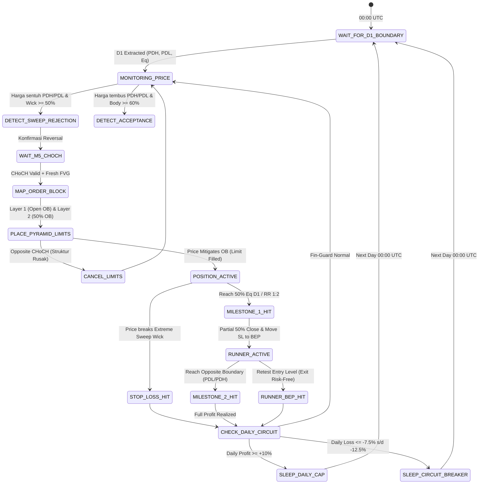

# Spesifikasi Teknis Lengkap: Standalone MTF SMC Scalper
## Sistem Multi-Timeframe Smart Money Concepts (D1 - H1 - M15/M5 - M1) dengan Order Block & Financial Circuit Breaker

**Track Riset:** Standalone Track (Track SMC - Bebas & Mandiri dari Eksperimen Sebelumnya)  
**Dokumen Induk:** [TICKET_MTF_SMC.md](TICKET_MTF_SMC.md)  
**Doktrin Tertinggi:** [AGENTS.md](../AGENTS.md) — Tiga Hukum Mutlak & Standar Baku Pelaporan  
**Versi:** 1.0.0 (Comprehensive Standalone Engineering Specification)  
**Tanggal:** 2026-11-09  

---

## 1. Arsitektur Multi-Timeframe Terintegrasi

Sistem ini memproses data streaming tick institusional secara hierarkis melintasi 4 tingkat waktu:

```
[ LEVEL D1 ] ──► Penentuan Batas Likuiditas Eksternal (PDH, PDL, Equilibrium 50%)
      │          Algoritma: Recursive Mother Bar Fallback (Inside Day Handler)
      ▼
[ LEVEL H1 ] ──► Penentu Kompas Order Flow & Bias Arah (Bullish / Bearish / Range)
      │
      ▼
[ LEVEL M15/M5 ] ► Evaluasi Reaksi Level: SWEEP (Rejection) vs ACCEPTANCE (Breakout)
      │
      ▼
[ LEVEL M5/M1 ] ──► Konfirmasi CHoCH + Pemetaan Fresh ORDER BLOCK (OB) & FVG
      │
      ▼
[ EKSEKUSI ] ──► Layered Pending Limit (Piramida 1.0% & 1.5% | Total Max 2.5%)
      │          SL: Pucuk Ekor Sweep + Buffer Spread
      ▼
[ EXIT MGMT ] ──► TP1 (50% Volume) di Eq 50% / RR 1:2 + Geser SL ke BEP
      │          TP2 (50% Volume) Runner di Likuiditas Seberang (PDL/PDH)
      ▼
[ CIRCUIT BREAKER ] ► Target Profit +10% Harian (Auto Lock & Sleep)
                      Max Loss -7.5% s/d -12.5% Harian (Auto Hard Stop)
                      Spread Guard <= 3.5 pips (24 Jam Non-Stop)
```

---

## 2. Formulasi Matematis & Logika Algoritma

### 2.1 Penentuan Batas D1 & Recursive Mother Bar Fallback (`d1_boundary_extractor.py`)
Setiap pergantian hari kalender pada pukul 00:00:00 UTC, sistem mengevaluasi candle harian:
* $High_{D-1}$, $Low_{D-1}$, $Close_{D-1}$, $Open_{D-1}$.

**Algoritma Mother Bar Fallback:**
```python
def extract_d1_boundaries(daily_bars: list[DailyBar]) -> tuple[float, float, float]:
    idx = -1  # Bar kemarin (D-1)
    
    # Deteksi Inside Bar: High < High sebelumnya dan Low > Low sebelumnya
    while idx >= -len(daily_bars) + 1:
        current_bar = daily_bars[idx]
        prev_bar = daily_bars[idx - 1]
        
        is_inside_bar = (current_bar.high < prev_bar.high) and (current_bar.low > prev_bar.low)
        if not is_inside_bar:
            break
        # Jika inside bar, mundur ke hari sebelumnya (Mother Bar)
        idx -= 1
        
    mother_bar = daily_bars[idx]
    pdh = mother_bar.high
    pdl = mother_bar.low
    equilibrium = (pdh + pdl) / 2.0
    
    return pdh, pdl, equilibrium
```

---

### 2.2 Penentuan Bias H1 (`h1_bias_classifier.py`)
Kompas arah menggunakan kombinasi struktur swing H1 dan EMA 20 H1:
* **BULLISH_BIAS:**
  $$\text{Close}_{H1} > \text{EMA20}_{H1} \quad \text{DAN} \quad \text{RecentSwingHigh} > \text{PreviousSwingHigh}$$
* **BEARISH_BIAS:**
  $$\text{Close}_{H1} < \text{EMA20}_{H1} \quad \text{DAN} \quad \text{RecentSwingLow} < \text{PreviousSwingLow}$$
* **NEUTRAL_RANGE:** Jika struktur saling tumpang tindih (*compression*).

---

### 2.3 Deteksi Reaksi Level M15/M5: Sweep vs Acceptance (`sweep_acceptance_engine.py`)
Saat harga menembus PDH atau PDL:

#### A. Skenario Liquidity Sweep (Rejection)
Kriteria matematis:
1. Harga menembus PDH: $\text{BarHigh} > \text{PDH}$.
2. Candle M15/M5 tutup kembali di bawah level: $\text{BarClose} \le \text{PDH}$.
3. Rasio Ekor Atas (*Upper Wick Ratio*):
   $$\text{WickRatio}_{upper} = \frac{\text{BarHigh} - \max(\text{BarOpen}, \text{BarClose})}{\text{BarHigh} - \text{BarLow}} \ge 0.50 \quad (50\%)$$
4. **Klasifikasi:** `SWEEP_REJECTION_PDH` $\rightarrow$ Mempersiapkan Setup **SELL**.

Sebaliknya untuk PDL:
1. Harga menembus PDL: $\text{BarLow} < \text{PDL}$.
2. Candle M15/M5 tutup kembali di atas level: $\text{BarClose} \ge \text{PDL}$.
3. Rasio Ekor Bawah (*Lower Wick Ratio*):
   $$\text{WickRatio}_{lower} = \frac{\min(\text{BarOpen}, \text{BarClose}) - \text{BarLow}}{\text{BarHigh} - \text{BarLow}} \ge 0.50 \quad (50\%)$$
4. **Klasifikasi:** `SWEEP_REJECTION_PDL` $\rightarrow$ Mempersiapkan Setup **BUY**.

#### B. Skenario Value Acceptance (Breakout Expansion)
Kriteria matematis:
1. Candle M15 tutup penuh di luar batas: $\text{BarClose} > \text{PDH}$ (untuk Bullish) atau $\text{BarClose} < \text{PDL}$ (untuk Bearish).
2. Rasio Body Candle:
   $$\text{BodyRatio} = \frac{|\text{BarClose} - \text{BarOpen}|}{\text{BarHigh} - \text{BarLow}} \ge 0.60 \quad (60\%)$$
3. Dorongan Volatilitas: $|\text{BarClose} - \text{BarOpen}| > 1.5 \times \text{ATR}_{14}(M15)$.
4. **Klasifikasi:** `VALUE_ACCEPTANCE` $\rightarrow$ Mempersiapkan Setup **Continuation / Retest Breaker Block**.

---

### 2.4 Konfirmasi CHoCH & Pemetaan Order Block M5/M1 (`order_block_mapper.py`)

#### A. Definisi CHoCH (Change of Character)
* **Bearish CHoCH (setelah Sweep PDH):** Candle M5/M1 mencatatkan **Body Close** di bawah Swing Low M5 terdekat.
* **Bullish CHoCH (setelah Sweep PDL):** Candle M5/M1 mencatatkan **Body Close** di atas Swing High M5 terdekat.

#### B. Pemetaan Koordinat Order Block (OB)
* **Bearish OB (-OB):** Candle *Bullish* terakhir tepat sebelum gelombang dorongan yang menyebabkan Bearish CHoCH.
  - $\text{OB}_{top} = \text{High}(\text{Candle}_{OB})$
  - $\text{OB}_{open} = \text{Open}(\text{Candle}_{OB})$ (Tepi Luar / Entry Layer 1)
  - $\text{OB}_{mean} = \frac{\text{High}(\text{Candle}_{OB}) + \text{Low}(\text{Candle}_{OB})}{2.0}$ (50% Mean Threshold / Entry Layer 2)
  - $\text{OB}_{bottom} = \text{Low}(\text{Candle}_{OB})$
* **Bullish OB (+OB):** Candle *Bearish* terakhir tepat sebelum gelombang dorongan yang menyebabkan Bullish CHoCH.
  - $\text{OB}_{open} = \text{Open}(\text{Candle}_{OB})$ (Tepi Luar / Entry Layer 1)
  - $\text{OB}_{mean} = \frac{\text{High}(\text{Candle}_{OB}) + \text{Low}(\text{Candle}_{OB})}{2.0}$ (50% Mean Threshold / Entry Layer 2)

#### C. Syarat Sah Imbalance (Fair Value Gap / FVG)
* Untuk Bullish OB: $\text{Low}(\text{Candle}_{i+2}) > \text{High}(\text{Candle}_{i})$ (Terdapat celah kosong).
* Untuk Bearish OB: $\text{High}(\text{Candle}_{i+2}) < \text{Low}(\text{Candle}_{i})$.
* Status wajib: **Unmitigated** (belum pernah dilewati oleh harga sejak terbentuk).

---

### 2.5 Eksekusi Pending Limit Piramida (`pyramid_limit_manager.py`)

Saat zona Order Block teridentifikasi sah:

#### A. Penempatan Layer Order
1. **Layer 1 (Open OB):**
   * Tipe: `LIMIT_ORDER` pada harga $\text{OB}_{open}$.
   * Alokasi Risiko: **$1.0\%$ dari Ekuitas Akun**.
2. **Layer 2 (Mean Threshold OB):**
   * Tipe: `LIMIT_ORDER` pada harga $\text{OB}_{mean}$.
   * Alokasi Risiko: **$1.5\%$ dari Ekuitas Akun**.
3. **Total Risiko Setup:** Maksimal **$2.5\%$** jika kedua limit tersentuh.

#### B. Penempatan Stop Loss (SL) Bersama
Kedua layer menggunakan satu titik Stop Loss mutlak:
* Untuk Posisi **SELL:**
  $$\text{SL} = \text{ExtremeHigh}(\text{SweepWick}) + \text{SpreadBuffer} \quad (\text{Buffer: } \$0.25)$$
* Untuk Posisi **BUY:**
  $$\text{SL} = \text{ExtremeLow}(\text{SweepWick}) - \text{SpreadBuffer}$$

#### C. Kalkulasi Ukuran Lot
Lot dihitung secara individual untuk masing-masing layer:
$$\text{Lot}_{Layer} = \frac{\text{Equity} \times \text{RiskPct}}{|\text{EntryPrice} - \text{SL}| \times \text{ContractSize}}$$

#### D. Aturan Pembatalan Order (Cancellation Rule)
Pending Limit **HANYA DIBATALKAN** jika:
* Terjadi **Opposite CHoCH** yang merusak struktur displacement asal.
* Selama struktur belum rusak, pending order tetap standby menunggu mitigasi harga.

---

### 2.6 Manajemen Keluar (Hybrid Exit Engine: `hybrid_exit_manager.py`)

Setiap posisi yang aktif dikelola dengan protokol dua tahap:

```
[ ENTRY FILLED ] ──► Pantau Harga Real-Time
       │
       ▼
[ MILESTONE 1: EQUILIBRIUM D1 (50%) ATAU RR 1:2.0 ]
       ├── 1. Eksekusi Partial Close: Tutup 50% Volume Posisi.
       └── 2. Geser SL sisa posisi ke Breakeven: BEP = EntryPrice + SpreadBuffer.
       │
       ▼ (Posisi kini 100% Bebas Risiko / Risk-Free)
       │
[ MILESTONE 2: LIKUIDITAS STRUKTURAL SEBERANG ]
       ├── Posisi SELL: Take Profit Final pada level PDL.
       └── Posisi BUY: Take Profit Final pada level PDH.
       └── Tutup 50% sisa volume posisi (Full Exit).
```

---

### 2.7 Protokol Keamanan Finansial (Daily Circuit Breaker: `daily_financial_guard.py`)

Sistem mengawasi ekuitas secara kontinu 24 jam non-stop:

1. **Daily Profit Cap (+10.0%):**
   * Jika $\text{RealizedPnL}_{hari\_ini} \ge +0.10 \times \text{StartingEquity}_{hari\_ini}$:
     - Seketika lakukan *market close* seluruh posisi aktif.
     - Batalkan (*cancel*) seluruh pending limit order yang masih standby.
     - Set status engine: `SLEEP_UNTIL_MIDNIGHT`.
     - Kunci profit di brankas hingga pergantian hari (00:00:00 UTC).

2. **Daily Drawdown Circuit Breaker (-7.5% s/d -12.5%):**
   * Jika $(\text{RealizedPnL}_{hari\_ini} + \text{UnrealizedPnL}) \le -\text{Threshold} \times \text{StartingEquity}$:
     - Seketika lakukan *hard close* semua posisi.
     - Batalkan seluruh pending limit order.
     - Set status engine: `CIRCUIT_BREAKER_TRIPPED`.
     - Matikan trading total hingga hari berikutnya demi melindungi $87.5\% - 92.5\%$ modal dari tren abnormal / black swan.

3. **Spread Guard Protection ($\le 3.5$ Pips):**
   * Sebelum memasang atau mengeksekusi limit order:
     $$\text{Spread} = \text{Ask} - \text{Bid}$$
   * Jika $\text{Spread} > \$0.35$ (3.5 pips / 35 points Exness):
     - Tahan (*freeze*) penempatan order baru.
     - Mencegah slippage saat rollover malam (04.00-06.00 WIB) atau saat lonjakan berita berdampak tinggi (CPI/NFP/FOMC).

4. **Operasional 24 Jam Non-Stop & Session Tagging:**
   * Bot memproses order di seluruh sesi: Asia, London, dan New York.
   * Setiap eksekusi diberi tag metadata sesi: `SESSION_ASIA`, `SESSION_LONDON`, `SESSION_NEWYORK` untuk bahan audit forensik.

---

## 3. Diagram State Machine Eksekusi



---

## 4. Standar Baku Pelaporan Hasil Pengujian (AGENTS.md Compliance)

Setelah implementasi modul selesai dan pengujian dijalankan pada 53,54+ juta tick riil Exness, laporan evaluasi **WAJIB MENAMPILKAN**:
1. **Tabel Ekuitas Berkelanjutan Bulanan (*Continuous Monthly Equity Carryover Table*):**
   * Dimulai dari modal awal **\$10.000,00** pada 1 April 2026.
   * Modal akhir bulan sebelumnya menjadi modal awal bulan berikutnya.
   * Kolom wajib: Bulan Kalender, Modal Awal (\$), Net PnL (\$), Modal Akhir (\$), Return (%), Max Drawdown (%), Total Trade, Win Rate (%), Profit Factor, dan Status Evaluasi.
2. **Tabel Rincian Arah Transaksi (BUY vs SELL Breakdown):**
   * Total Trade, Trade BUY & PnL BUY, Trade SELL & PnL SELL, serta Keterangan Karakteristik Pasar.
3. **Audit Forensik Mendalam:**
   * Analisis perilaku Order Block, rasio efektivitas piramida, performa jam sesi (Asia vs London vs NY), dan efektivitas circuit breaker harian.
