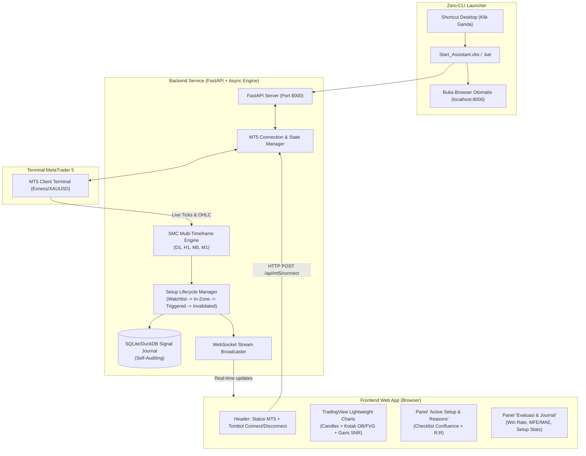

# SPESIFIKASI SISTEM & TIKET PENGEMBANGAN
## XAUUSD SMC Personal Trading Analyst Assistant (Web Dashboard & Decision Support)

Dokumen ini mendefinisikan arsitektur teknis, alur data, spesifikasi antarmuka, dan rincian tiket kerja implementasi untuk membangun **Asisten Analis Pribadi XAUUSD** yang interaktif, mandiri, dan bebas dari pengetikan perintah manual di terminal (Zero-CLI).

---

## 1. Arsitektur Tingkat Tinggi (High-Level Architecture)



---

## 2. Fitur Kunci & Prinsip Kerja

### A. Zero-CLI & In-Browser One-Click Connection
* **Pengguna tidak perlu mengetik perintah apapun di CMD.**
* Sebuah file launcher sekali klik (`Start_Assistant.bat` atau `.vbs` tanpa jendela hitam CMD) akan:
  1. Mengaktifkan `.venv` secara hening di latar belakang.
  2. Menjalankan server aplikasi lokal.
  3. Membuka browser bawaan (Chrome/Edge) ke alamat `http://localhost:8000`.
* Di pojok kanan atas antarmuka web, terdapat badge indikator status:
  * 🔴 **Terputus (Disconnected):** Tombol hijau `[ Sambungkan ke MT5 ]`
  * 🟢 **Terhubung (Connected):** Tombol merah `[ Putuskan MT5 ]` + Info Akun (Nomor Akun, Ping/Latency, Spread XAUUSD).
* Klik tombol tersebut akan mengirimkan permintaan API ke backend untuk menginisialisasi atau memutus sesi MT5 secara aman.

### B. Siklus Hidup Setup (Setup Lifecycle State Machine)
Asisten tidak memberikan sinyal dadakan yang membuat panik, melainkan mengelola status setup secara terstruktur:

| Status | Indikator Visual | Keterangan & Perilaku |
| :--- | :--- | :--- |
| **`WATCHLIST`** | Warna Kuning / Oranye | Zona POI (Order Block / FVG / SNR) terdeteksi. Harga masih berjarak dari zona. Ditampilkan lebih awal agar pengguna siap. |
| **`IN_ZONE`** | Warna Biru / Berkedip | Harga telah memasuki batas zona POI. Memulai pemantauan konfirmasi di M1 (*rejection wick* / *engulfing*). |
| **`TRIGGERED`** | Warna Hijau (BUY) / Merah (SELL) | Konfirmasi terpenuhi. Muncul rekomendasi Entry, SL, TP, dan daftar alasan (*confluences*). |
| **`INVALIDATED`** | Warna Abu-abu / Coret | Setup dibatalkan karena harga lari menjauh membuat struktur baru tanpa retest, atau zona ditembus secara agresif. |
| **`COMPLETED`** | Warna Hijau Solid / Merah Solid | Setup selesai (mencapai target TP atau menyentuh SL). Dicatat ke database untuk evaluasi. |

### C. Mesin Penalaran Konfluensi (Reasoning Engine)
Setiap setup yang direkomendasikan wajib disertai daftar alasan terstruktur:
* **Arah Struktur H1:** (*Bullish Order Flow / Bearish Order Flow*)
* **Pemicu Likuiditas (*Liquidity Catalyst*):** (*Asian Low Swept / PDH Swept / Equal Highs Run*)
* **Lokasi Reaksi (*Zone Location*):** (*M5 Bullish Order Block 50% Mean Threshold @ 2651.20*)
* **Status Imbalance:** (*Unmitigated M1 Fair Value Gap filled*)
* **Rasio Risk-to-Reward:** (*1 : 2.5 hingga 1 : 3.5*)

---

## 3. Struktur Direktori Proyek Baru

Modul baru akan disematkan langsung di dalam repositori ini tanpa merusak kode riset yang sudah ada:

```text
xauusd/
├── Start_Assistant.bat              <-- Launcher sekali klik untuk pengguna
├── Start_Assistant.vbs              <-- Launcher senyap (tanpa jendela hitam CMD)
├── src/
│   ├── assistant/                   <-- MODUL BARU: Asisten Analis
│   │   ├── __init__.py
│   │   ├── app.py                   <-- FastAPI Application & Router
│   │   ├── mt5_bridge.py            <-- Pengelola Koneksi MT5 (Connect/Disconnect/Status)
│   │   ├── state_manager.py         <-- Mesin Siklus Hidup Setup (Watchlist, Triggered, Invalidation)
│   │   ├── reasoning_engine.py      <-- Generator Checklist Alasan Masuk Posisi
│   │   ├── journal_repository.py    <-- Penyimpanan Database SQLite untuk Evaluasi & Log
│   │   └── templates/
│   │       └── index.html           <-- Halaman Web Dashboard
│   │   └── static/
│   │       ├── css/
│   │       │   └── dashboard.css
│   │       └── js/
│   │           ├── chart_engine.js  <-- Integrasi TradingView Lightweight Charts
│   │           ├── ws_client.js     <-- Klien WebSocket Real-time
│   │           └── app.js           <-- Logika UI & Tombol Connect/Disconnect
│   └── strategies/smc/              <-- Menggunakan modul yang SUDAH ADA
│       ├── d1_boundary_extractor.py
│       ├── h1_bias_classifier.py
│       ├── sweep_acceptance_engine.py
│       └── order_block_mapper.py
```

---

## 4. Rincian Tiket Implementasi (Work Tickets)

### Epic 1: Konektor MT5 & Layanan Backend (Zero-CLI Core)
* **`T-01: MT5 Connection Bridge API`**
  * *Tujuan:* Membuat kelas `MT5Bridge` dengan kemampuan `initialize()`, `shutdown()`, dan `get_status()`.
  * *Endpoint:*
    * `GET /api/mt5/status`: Mengembalikan status koneksi, info akun (login, saldo, ekuitas), dan spread saat ini.
    * `POST /api/mt5/connect`: Menghubungkan ke terminal MT5 lokal tanpa membuka terminal CMD.
    * `POST /api/mt5/disconnect`: Memutus koneksi MT5 secara bersih.
* **`T-02: Real-time Candle & Tick Streamer via WebSocket`**
  * *Tujuan:* Menyediakan jalur streaming data M1, M5, dan H1 XAUUSD ke frontend via WebSocket (`/ws/stream`).
  * *Kriteria Selesai:* Candlestick M1 ter-update secara berkala saat tick baru tiba.

---

### Epic 2: Logika Analis SMC & Siklus Setup
* **`T-03: Integrasi Engine SMC ke Live Feed`**
  * *Tujuan:* Menghubungkan streaming bar MT5 ke modul `D1BoundaryExtractor`, `H1BiasClassifier`, dan `OrderBlockMapper`.
  * *Kriteria Selesai:* Sistem mampu mengekstrak batas harian (PDH, PDL, Asian Range) dan zona OB/FVG aktif dari data live.
* **`T-04: Setup State Machine (Watchlist & Invalidation)`**
  * *Tujuan:* Menerapkan logika status setup (`WATCHLIST`, `IN_ZONE`, `TRIGGERED`, `INVALIDATED`).
  * *Aturan Pembatalan:* Jika harga membuat titik ekstrem baru tanpa memitigasi zona atau jika batas waktu sesi habis, status berubah menjadi `INVALIDATED`.
* **`T-05: Confluence Reasoning Builder`**
  * *Tujuan:* Membentuk struktur data JSON berisi alasan teknis lengkap (Bias, Sweep target, Zone type, R:R) untuk setiap setup aktif.

---

### Epic 3: Tampilan Antarmuka Web (TradingView Lightweight Charts)
* **`T-06: Antarmuka Web Dasar & Header Kontrol MT5`**
  * *Tujuan:* Membangun layout web modern (Dark Mode) dengan header status MT5, tombol `[ Connect / Disconnect ]`, indikator spread, dan latency.
* **`T-07: Integrasi TradingView Lightweight Charts`**
  * *Tujuan:* Menampilkan chart candlestick XAUUSD interaktif (zoom, scroll, responsive) menggunakan library resmi TradingView Lightweight Charts.
* **`T-08: Overlay Visual Objek SMC (Kotak OB/FVG & Garis SNR)`**
  * *Tujuan:* Menggambar kotak semi-transparan untuk Bullish/Bearish Order Block, area FVG, dan garis putus-putus untuk PDH/PDL/Asian Range langsung di atas canvas chart.
* **`T-09: Panel Rekomendasi Sinyal & Reasoning Card`**
  * *Tujuan:* Menampilkan kartu sinyal aktif di samping chart dengan badge status (Kuning untuk Watchlist, Hijau untuk Triggered) beserta rincian Entry, SL, TP, dan checklist alasan.

---

### Epic 4: Launcher Desktop Satu Klik (Zero-CLI)
* **`T-10: Script Launcher Otomatis (Batch & VBS)`**
  * *Tujuan:* Membuat file `Start_Assistant.bat` dan `Start_Assistant.vbs`.
  * *Perilaku:* Menjalankan server Python di background secara otomatis dan memanggil browser web membuka `http://localhost:8000` tanpa memunculkan jendela hitam terminal.

---

### Epic 5: Sistem Evaluasi Mandiri (Self-Auditing Journal)
* **`T-11: SQLite Setup Journal & Outcome Tracker`**
  * *Tujuan:* Menyimpan riwayat setiap setup yang muncul (waktu, jenis setup, harga entry, target, alasan).
* **`T-12: Pelacakan Performa Pasca-Sinyal (MFE / MAE / Win Rate)`**
  * *Tujuan:* Menghitung apakah setup yang direkomendasikan mencapai TP atau SL, serta menampilkan ringkasan performa mingguan di tab "Evaluasi".
