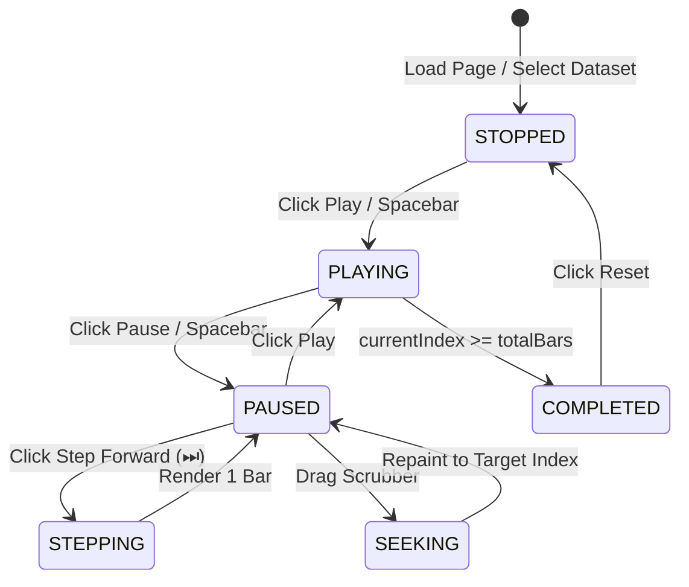

# SPESIFIKASI REKAYASA TEKNIS
## Interactive Visual Backtest Replay Engine (XAUUSD M5/M15 Scalper)

**Dokumen ID:** `SPEC-REPLAY-01`  
**Status:** DRAFT / PENDING REVIEW  
**Kategori:** Web Visual Testing & Simulation Engine  
**Target Platform:** Web Assistant Dashboard (`src/assistant/`)  
**Doktrin Tertinggi:** [`AGENTS.md`](file:///c:/Users/pendi/Repository/RESEARCH%20SCALPING/xauusd/AGENTS.md)

---

## 1. Latar Belakang & Tujuan (Background & Objective)

Dalam proses evaluasi strategi kuantitatif, analisis berbasis tabel angka dan metrik statistik sering kali tidak memberikan pemahaman intuitif mengenai **bagaimana harga berinteraksi secara mikro dengan level teknikal**. 

User membutuhkan media visual interaktif layaknya **TradingView Bar Replay** atau **MT5 Visual Strategy Tester**, di mana pergerakan lilin historis dapat diputar ulang (*replay*) batang demi batang (*bar-by-bar*), lengkap dengan:
1. Penanda visual posisi masuk (*Entry marker: BUY/SELL*).
2. Garis batas risiko (*Stop Loss*) dan target keuntungan (*Take Profit*).
3. Penanda penutupan posisi (*Exit marker: TP HIT / SL HIT* dengan nominal PnL).
4. Kotak arsiran struktur (*RBS/SBR retest zone & liquidity sweep boundaries*).
5. Pengendali pemutaran dinamis (*Play/Pause, Step Forward 1 Bar, Speed Multiplier 1x–100x, Timeline Scrubber*).
6. Tampilan metrik saldo berjalan (*Live Floating PnL & Real-Time Equity Curve*).

Semua ini harus berjalan **mulus (60 FPS), tanpa lag buffering, dan Zero-CLI** melalui browser.

---

## 2. Arsitektur Sistem (System Architecture)

Sistem menggunakan model **Client-Side High-Performance Replay Architecture**:

```
+-----------------------------------------------------------------------------------+
| BACKEND (Python FastAPI)                                                          |
| `src/assistant/replay_api.py`                                                     |
|                                                                                   |
|  1. Baca Parquet Bars (data/cache_bars/) M5 & M15                                |
|  2. Jalankan Mode A Pro-Trend Scalper Engine (experiments_isolated/)              |
|  3. Kemas Candlesticks + Trades + Zones ke dalam format Single JSON Payload       |
+-----------------------------------------------------------------------------------+
                                       │
                                       │ HTTP GET /api/replay/data (Sekali muat)
                                       ▼
+-----------------------------------------------------------------------------------+
| FRONTEND (TradingView Lightweight Charts + Vanilla JS)                            |
| `src/assistant/static/js/replay.js`                                               |
|                                                                                   |
|  1. Replay State Machine (STOPPED, PLAYING, PAUSED, COMPLETED)                    |
|  2. Replay Clock Engine (requestAnimationFrame / Timer terkontrol Speed Slider)    |
|  3. Incremental Bar Appender (series.update(bar))                                  |
|  4. Dynamic Marker & PriceLine Manager (Entry, SL, TP, Win/Loss)                   |
|  5. Real-Time HUD (Saldo Compounding, Floating PnL, Win Rate)                     |
|  6. Synchronous Mini Equity Chart                                                 |
+-----------------------------------------------------------------------------------+
```

### Mengapa Client-Side Replay?
- **Zero Latency:** Setelah data dimuat satu kali (~1-2 detik untuk 10.000 batang lilin), pemutaran ulang berjalan 100% di memori browser.
- **Scrubbing Instan:** Menggeser *slider* waktu maju atau mundur tidak membutuhkan request baru ke server MT5/Python.
- **Kecepatan Fleksibel:** Bisa diputar dari 1 detik/lilin (1x) hingga 100 lilin/detik (100x) tanpa risiko *network congestion*.

---

## 3. Spesifikasi Kontrak Data API (API Data Contract)

### Endpoint: `GET /api/replay/sessions`
Mengembalikan daftar sesi pengujian historis yang tersedia.

**Response Schema:**
```json
{
  "sessions": [
    {
      "id": "2y_protrend_m5",
      "name": "2 Tahun Pro-Trend Scalper (Nov 2024 - Nov 2026)",
      "timeframe": "M5",
      "macro_timeframe": "M15",
      "start_date": "2024-11-01",
      "end_date": "2026-11-16",
      "total_bars": 125000,
      "total_trades": 423
    }
  ]
}
```

### Endpoint: `GET /api/replay/data`
**Query Parameters:**
- `session_id`: ID sesi atau rentang tanggal kustom (`start_date`, `end_date`).
- `strategy`: `mode_a_pure` (default) atau `dual_mode`.
- `rr_ratio`: Rasio R:R (default `1.5`).

**Response Payload Schema:**
```json
{
  "meta": {
    "symbol": "XAUUSD",
    "timeframe": "M5",
    "initial_capital": 10000.0,
    "final_capital": 18822.89,
    "total_return_pct": 88.23,
    "max_drawdown_pct": 15.61,
    "win_rate": 48.2,
    "total_trades": 423
  },
  "candles": [
    {
      "time": 1730419200,
      "open": 2745.20,
      "high": 2748.10,
      "low": 2744.50,
      "close": 2747.80,
      "volume": 320
    }
  ],
  "trades": [
    {
      "trade_id": "T-001",
      "side": "BUY",
      "entry_idx": 45,
      "entry_time": 1730432700,
      "entry_price": 2748.50,
      "sl_price": 2743.50,
      "tp_price": 2756.00,
      "sl_dist": 5.00,
      "tp_dist": 7.50,
      "lot": 0.30,
      "exit_idx": 58,
      "exit_time": 1730436600,
      "exit_price": 2756.00,
      "outcome": "WIN",
      "pnl": 225.00,
      "equity_after": 10225.00,
      "reason": "M15 Bullish Expansion + M5 RBS Retest @ 2748.00 + 42% Lower Wick"
    }
  ],
  "zones": [
    {
      "type": "RBS",
      "start_idx": 40,
      "end_idx": 50,
      "top": 2749.20,
      "bottom": 2747.80
    }
  ]
}
```

---

## 4. Spesifikasi Komponen Frontend (UI/UX Specification)

### 4.1. Toolbar Kontrol Replay (Replay Control Bar)
Terletak di bagian atas panel chart:
1. **Tombol Play / Pause:** Toggle ikon `▶ / ⏸` (Shortcut: `Spacebar`).
2. **Tombol Step 1 Bar:** Ikon `⏭` untuk memajukan lilin tepat 1 bar (Shortcut: `Right Arrow` / $\rightarrow$).
3. **Tombol Step Back 1 Bar:** Ikon `⏮` untuk memundurkan lilin 1 bar (Shortcut: `Left Arrow` / $\leftarrow$).
4. **Pill Presets Kecepatan:** `0.5x`, `1x`, `2x`, `5x`, `10x`, `25x`, `50x`, `Max`.
5. **Timeline Scrubber (Slider):** Slider horizontal dengan tooltip tanggal & waktu saat di-hover/geser.
6. **Timeframe Selector:** Switch cepat antara M5 dan M15.

### 4.2. Render Visual Chart (TradingView Lightweight Charts)
1. **Candlestick Series:** Lilin dirender bertahap dari indeks 0 hingga indeks saat ini (`currentIndex`).
2. **Trade Markers (Marker API):**
   - **Saat Entry Terjadi:** Muncul panah hijau (`arrowUp`) di bawah lilin untuk BUY, atau panah merah (`arrowDown`) di atas lilin untuk SELL.
   - **Saat Exit Terjadi:** Muncul penanda di titik close:
     - Hijau `circle` / `check` bertuliskan `TP HIT +$XXX.XX`
     - Merah `cross` bertuliskan `SL HIT -$YYY.YY`
3. **Active Trade Price Lines (`createPriceLine`):**
   - Selama posisi sedang terbuka (antara `entry_idx` dan `exit_idx`):
     - **Garis Biru Dotted:** Titik Entry aktif.
     - **Garis Hijau Dashed:** Target TP.
     - **Garis Merah Dashed:** Batas SL.
   - Begitu posisi ditutup, ketiga garis ini otomatis dihapus dan digantikan oleh penanda riwayat (*historical marker*).

### 4.3. Heads-Up Display (Live Replay HUD)
Panel melayang (*floating HUD*) transparan di sudut kanan atas chart:
- **Status Transaksi:** `IDLE` (menunggu setup) atau `IN_TRADE` (BUY 0.30 lot @ 2748.50).
- **Floating PnL:** Bergerak dinamis sesuai harga *close* lilin terkini (`+$125.00` atau `-$45.00`).
- **Saldo Ekuitas Berjalan:** Compounding akumulatif ($10.000 $\rightarrow$ \$18.822).
- **Statistik Berjalan:** Total Closed Trades, Win Rate saat ini, Current Max Drawdown.
- **Jam & Tanggal Simulasi:** Timestamp bar yang sedang aktif (UTC).

### 4.4. Mini Equity Curve Sub-Chart
Grafik garis kecil di bawah chart utama yang menampilkan perkembangan modal secara sinkron dengan batang lilin yang sedang diputar.

---

## 5. State Machine & Siklus Hidup Replay (Replay State Machine)



---

## 6. Standar Kualitas & Non-Fungsional (Quality Attributes)

1. **Performa Rendering:** 60 FPS stabil pada monitor standar. Pembaruan lilin per *frame* menggunakan `series.update()` tanpa merender ulang seluruh dataset.
2. **Presisi Matematika:** Saldo dan PnL pada replay wajib **100% identik** dengan hasil laporan resmi backtest runner (bebas dari anomali pembulatan).
3. **Zero-CLI:** Pengguna cukup menjalankan `Start_Assistant.bat` dan memilih tab "Visual Replay" di browser tanpa menyentuh command prompt.
4. **Isolasi Kode:** Seluruh logika pengujian replay mengambil data dari modul terisolasi `experiments_isolated/m15_m5_dual_retest_scalper/` tanpa mencampuri modul eksperimen lain.
